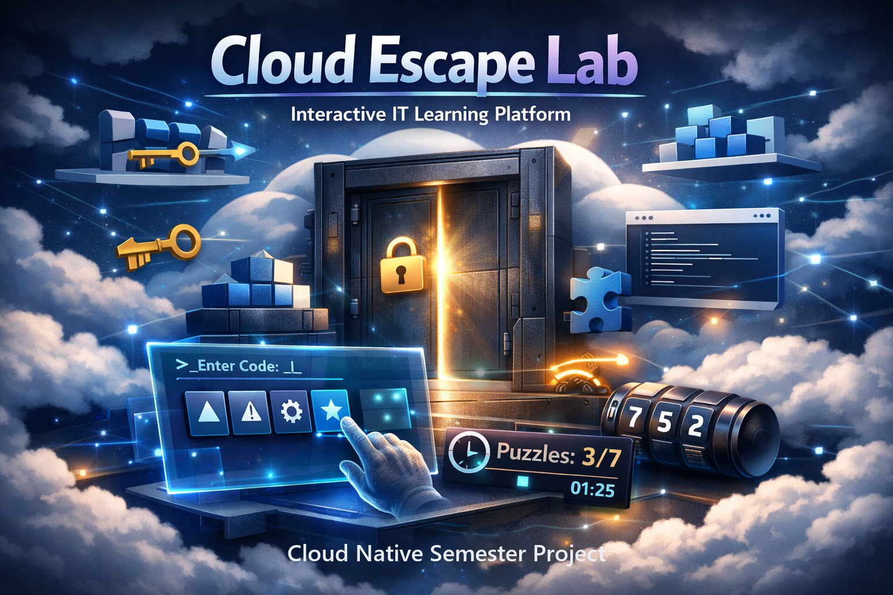
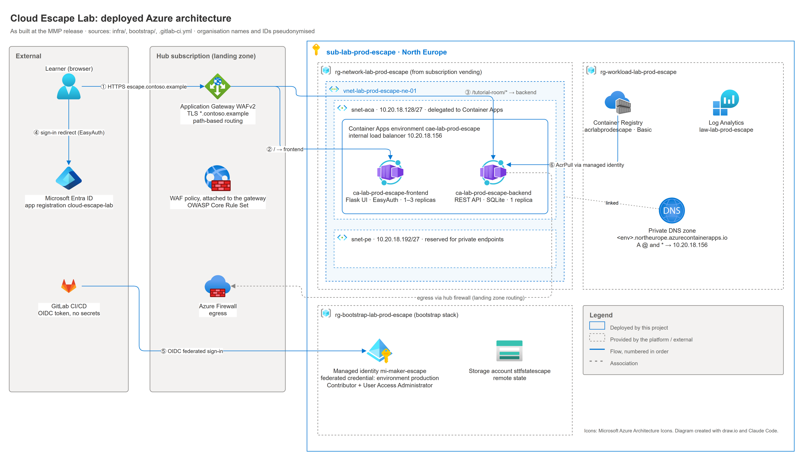
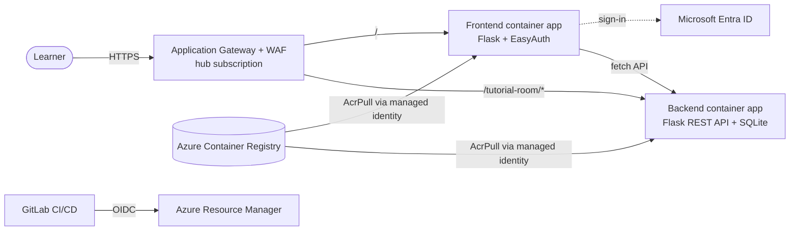

# Cloud Escape Lab

**A cloud-native escape room platform for hands-on IT learning, running on Azure Container Apps behind a central Application Gateway/WAF, secured with Microsoft Entra ID and delivered entirely through OpenTofu and a secretless GitLab CI/CD pipeline.**




## What it is

Learners solve technical puzzles in themed escape rooms instead of working through isolated exercises. This proof of concept delivers the platform behind the game: a containerised frontend and backend, a fully playable tutorial room, and an Azure environment that is built, secured and updated without manual portal work.

The platform is deployed into a spoke subscription of an existing hub-and-spoke landing zone at a fictitious university (*Contoso University*). Public traffic only enters through the hub's Application Gateway with WAF; the workloads themselves have no public endpoints.

## Highlights

- **Microservices on Azure Container Apps**: Flask frontend and REST backend as separate container apps in a VNet-integrated environment with an internal load balancer.
- **Hub-and-spoke ingress**: TLS termination, OWASP CRS WAF and path-based routing (`/` → frontend, `/tutorial-room/*` → backend) at the central Application Gateway.
- **Entra ID authentication without app code**: Container Apps built-in authentication (EasyAuth), configured with `azapi`, including a fix for redirect URIs behind a reverse proxy (`X-Forwarded-Host`).
- **Secretless delivery**: GitLab authenticates to Azure via OIDC federated credentials; images are pulled with managed identities (`AcrPull`), so no passwords or keys are stored anywhere.
- **Everything as code**: a one-off bootstrap stack and a modular platform stack in OpenTofu with remote state in Azure Storage.
- **Security gates in CI**: `terraform fmt`/`validate`, `tflint`, Checkov and `pip-audit` on merge requests; Trivy scans every image pulled straight from the registry.
- **Tested end to end**: 10 of 10 test cases passed against the deployed environment.

## Architecture





Details: [architecture](docs/architecture.md) and [delivery pipeline](docs/delivery.md).

## Tech stack

| Area | Technology |
|---|---|
| Application | Python, Flask/APIFlask, Jinja2, SQLAlchemy, SQLite, JWT |
| Runtime | Docker, Azure Container Apps (Consumption), Azure Container Registry |
| Network and security | Hub-and-spoke VNet, Application Gateway WAFv2, Private DNS, managed identities |
| Identity | Microsoft Entra ID, Container Apps EasyAuth, OIDC federated credentials |
| Infrastructure as Code | HCL for OpenTofu/Terraform (`azurerm`, `azapi`), remote state in Azure Storage; the pipeline runs the Terraform 1.7 CLI |
| CI/CD and quality | GitLab CI/CD, tflint, Checkov, pip-audit, Trivy |

## Run it locally

```bash
# backend: REST API on http://localhost:5001 (Swagger UI at /docs)
cd backend && pip install -r requirements.txt && python wsgi.py

# frontend: web UI on http://localhost:5000
cd frontend && pip install -r requirements.txt && python wsgi.py
```

Open http://localhost:5000, choose *Start Tutorial Room* and play. Deploying to Azure is described in [docs/delivery.md](docs/delivery.md).

## Repository structure

```text
frontend/     Flask web UI (templates, static assets, health endpoint)
backend/      Flask REST API with the game engine and the tutorial room
bootstrap/    one-off OpenTofu stack: state backend, OIDC identity, Entra app registration
infra/        platform stack: network, ACR, Container Apps environment, apps, EasyAuth
ci/           custom CI image (Azure CLI, Docker CLI, Trivy)
docs/         documentation, diagrams and test recordings
```

## Documentation

| Document | Content |
|---|---|
| [Architecture](docs/architecture.md) | Solution design, Azure target architecture, routing, identity, EasyAuth behind a proxy |
| [Delivery](docs/delivery.md) | Bootstrap, OpenTofu stacks and modules, CI/CD pipeline, OIDC, image scanning |
| [Testing](docs/testing.md) | Test approach and 10 end-to-end test cases with recordings |
| [Project management](docs/project-management.md) | Goals, scope, risks, SWOT, roadmap, sprints |
| [Retrospective](docs/retrospective.md) | Lessons learned, conclusions, next steps |
| [Glossary](docs/glossary.md) | Terms and references |
| [Backend](backend/README.md) · [Frontend](frontend/README.md) · [Tutorial room](backend/app/rooms/tutorial/README.md) | Component documentation |

## Project context

Individual semester project (3rd semester) of the Higher Diploma in Computer Science, specialisation Cloud Native, in spring 2026. Built in four Scrum sprints with MVP, MLP and MMP releases. Organisation names, domains and IDs in this repository are pseudonymised.

## Licence and attribution

The tutorial room (`frontend/app/templates/tutorial.html`, `backend/app/rooms/tutorial/`) is adapted from [`ma-room-template`](https://gitlab.com/solvista/ma-room-template) and is licensed under **CC BY-SA 4.0**. See [NOTICE](NOTICE) and [LICENSE](LICENSE). The platform, infrastructure and pipeline code was written for this project.

## Author

Marlon Burri, [github.com/marlonburri03](https://github.com/marlonburri03)
