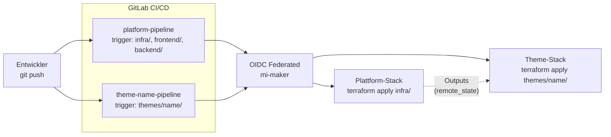

# Cloud-based escape room platform


*Das Image wurde mit Microsoft Copilot erstellt.*

---

# Inhaltsverzeichnis

[[ _TOC_ ]]

---

## 1 Einleitung

In dieser Arbeit wird eine Cloud-basierte Escape-Room-Plattform entwickelt, welche zur interaktiven Vermittlung von IT-Wissen dient. Die Plattform ermöglicht es Lernenden, technische Herausforderungen und Rätsel in einer praxisnahen und spielerischen Umgebung zu lösen. Ziel ist es, theoretische Inhalte aus der IT-Ausbildung mit realitätsnahen Szenarien zu kombinieren und dadurch den Lernerfolg nachhaltig zu verbessern.

Die Plattform basiert auf einer Cloud-nativen Microservice-Architektur und wird im Azure Tenant der Contoso University umgesetzt. Escape Rooms werden automatisiert über GitLab CI/CD Pipelines bereitgestellt und betrieben. Zusätzlich erfolgt die Authentifizierung über Microsoft Entra ID, wodurch eine sichere und kontrollierte Nutzung gewährleistet wird. Die Infrastruktur wird mithilfe von Infrastructure as Code (OpenTofu / Terraform) automatisiert und reproduzierbar bereitgestellt.

Die Arbeit dient als proof of concept (POC) für eine moderne und interaktive Lernplattform im Bereich der IT-Ausbildung. Sofern sich das Konzept bewährt, ist eine Weiterentwicklung mit zusätzlichen Szenarien und Funktionen vorgesehen.

Die Arbeit stützt sich auf das im dritten Semester des Lehrgangs zum dipl. Informatiker HF mit Vertiefung in Cloud Native erarbeitete Fachwissen und wurde von Marlon Burri als Einzelarbeit konzipiert und umgesetzt.

## 1.1 Behandelte Module

- Microservices mit Python
- Relationale Datenbanken
- Datensicherheit
- Containersicherheit
- Netzwerk
- Projektmanagement
- Infrastructure as Code (IaC)
- Function as a Service (FaaS)
- Microsoft Azure Cloud

---

# Projektorganisation

```mermaid
flowchart TB
  subgraph Projekthierarchie[Projekthierarchie]
    direction TB

    subgraph Lehrgangsleitung
      Lehrgangsleiter[Lehrgangsleiter]
    end

    subgraph Projektbegleitung
      direction LR
      Projektleiter[Projektleiter]
      Fachdozent[Fachdozent]
    end

    subgraph Studierender
      Stud[Marlon Burri]
    end
  end

  Lehrgangsleiter <--> Projektleiter
  Lehrgangsleiter <--> Fachdozent
  Projektleiter <--> Stud
  Fachdozent <--> Stud

  linkStyle default stroke:#94a3b8,stroke-width:1.5px;
  style Projekthierarchie fill:#f8fafc,stroke:#e2e8f0,color:#334155,stroke-width:1px;
  style Lehrgangsleitung fill:#f8fafc,stroke:#dbe2ea,color:#334155,stroke-width:1px;
  style Projektbegleitung fill:#f8fafc,stroke:#dbe2ea,color:#334155,stroke-width:1px;
  style Studierender fill:#f8fafc,stroke:#dbe2ea,color:#334155,stroke-width:1px;

  classDef mentors fill:#f1f5f9,color:#334155,stroke:#cbd5e1,stroke-width:1.5px;
  classDef student fill:#dcfce7,color:#166534,stroke:#86efac,stroke-width:1.5px;

  class Lehrgangsleiter,Projektleiter,Fachdozent mentors;
  class Stud student;
  ```

## 2.1 Problemstellung

In der heutigen IT-Ausbildung werden technische Inhalte häufig theoretisch oder anhand isolierter Übungen vermittelt. Dies erschwert es Lernenden, komplexe Zusammenhänge praxisnah zu verstehen und in realistischen Szenarien anzuwenden.

Zusätzlich erfordern viele technische Themen ein hohes Mass an Eigeninitiative und praktischem Verständnis, welches durch klassische Lernmethoden nur begrenzt gefördert wird. Moderne Lernansätze wie Gamification oder interaktive Challenges gewinnen deshalb zunehmend an Bedeutung.

Mit dieser Arbeit soll eine Cloud-basierte Escape-Room-Plattform entwickelt werden, welche IT-Wissen spielerisch und praxisorientiert vermittelt. Die Plattform kombiniert moderne Cloud-Technologien, Microservices, CI/CD sowie Infrastructure as Code und ermöglicht Lernenden, technische Herausforderungen innerhalb realistischer Szenarien zu lösen.

## 2.2 Aufgabenstellung

Basierend auf der beschriebenen Problemstellung ist das Ziel dieser Arbeit die Entwicklung einer Cloud-basierten Escape-Room-Plattform für die interaktive Vermittlung von IT-Wissen. Die Plattform soll mindestens ein vollständig spielbares Escape-Room-Szenario bereitstellen und eine moderne Cloud-native Architektur verwenden.

Zur Umsetzung wird eine Microservice-Architektur eingesetzt, bei welcher Frontend, Backend und Spiellogik voneinander getrennt entwickelt und betrieben werden. Die Bereitstellung der Plattform erfolgt automatisiert über GitLab CI/CD Pipelines. Zusätzlich wird die Infrastruktur mithilfe von OpenTofu (Terraform) als Infrastructure as Code umgesetzt.

## 2.3 Ziele

- Entwicklung einer funktionalen Cloud-basierten Escape-Room-Plattform mit mindestens einem vollständig spielbaren Szenario
- Umsetzung einer Microservice-Architektur mit getrennten Komponenten für Frontend, Backend und Spiellogik
- Aufbau einer automatisierten CI/CD Pipeline mit GitLab für Build, Testing und Deployment
- Integration einer Authentifizierungslösung mittels Microsoft Entra ID inklusive rollenbasierter Zugriffskontrolle
- Automatisierte Bereitstellung der Infrastruktur mithilfe von OpenTofu (Terraform)
- Implementierung mindestens einer Azure Function zur Verarbeitung von Spielinteraktionen
- Einsatz einer relationalen Datenbank zur Speicherung von Spielständen, Sessions oder Benutzerinformationen
- Erstellung einer vollständigen Projektdokumentation inklusive Architekturübersicht, Deployment-Prozess und Lessons Learned

## 2.4 Sachmittel

Microsoft Azure Portal & CLI
GitLab
Jira (SCRUM-Board)
Visual Studio Code
Docker / Docker Compose
OpenTofu (Terraform)
Microsoft Entra ID
AI-Tools (ChatGPT, Claude, Copilot etc.)
JavaScript / TypeScript
Python
PostgreSQL
Azure Functions

## 2.5 Vorgaben, Methoden und Werkzeuge

__Projektmethodik:__

Für die Umsetzung des Projekts wird SCRUM als agile Projektmanagementmethode eingesetzt. Die Entwicklung erfolgt iterativ in mehreren Sprints, wodurch regelmässig funktionsfähige Zwischenstände entstehen, welche überprüft und bei Bedarf angepasst werden können. Nach jedem Sprint werden Reviews und Retrospektiven durchgeführt, um den aktuellen Projektstand zu evaluieren und das weitere Vorgehen gezielt zu optimieren.

__Projektmanagement:__

Für die Planung, Organisation und Steuerung des Projekts wird Jira eingesetzt. Sämtliche User Stories, Tasks, Sprint-Planungen sowie Fortschritte werden zentral verwaltet, um eine strukturierte und nachvollziehbare Projektorganisation sicherzustellen.

__Versionsverwaltung und Dokumentation:__

GitLab wird für die Versionsverwaltung, Dokumentation sowie die Nachverfolgung sämtlicher Änderungen verwendet. Der gesamte Quellcode, die Infrastrukturdefinitionen sowie die technische Dokumentation werden zentral in einem GitLab-Repository verwaltet.

Die Projektdokumentation erfolgt fortlaufend in Markdown-Dateien innerhalb des Repositories und wird durch Commit Messages ergänzt, um die Nachvollziehbarkeit aller Änderungen sicherzustellen. Zusätzlich wird GitLab CI/CD zur Automatisierung von Build-, Test- und Deployment-Prozessen eingesetzt.

__Systemarchitektur und technische Umsetzung:__

Die Plattform basiert auf einer Cloud-nativen Microservice-Architektur und wird im Azure Tenant der Contoso University umgesetzt. Einzelne Komponenten wie Frontend, Backend, Spiellogik sowie serverlose Funktionen werden voneinander getrennt entwickelt und betrieben, um eine flexible, skalierbare und wartbare Architektur zu gewährleisten.

Das Frontend wird mit JavaScript beziehungsweise TypeScript umgesetzt. Für die Backend- und API-Komponenten wird Python verwendet. Die Kommunikation zwischen den einzelnen Diensten erfolgt über definierte Schnittstellen und APIs.

Die Plattform wird containerisiert betrieben. Dafür werden Docker und Docker Compose eingesetzt, um die einzelnen Services lokal sowie in der Cloud reproduzierbar bereitzustellen.

__Cloud und Infrastruktur:__

Die Bereitstellung der Infrastruktur erfolgt mittels Infrastructure as Code unter Verwendung von OpenTofu (Terraform-kompatibel). Dadurch kann die gesamte Umgebung automatisiert, standardisiert und reproduzierbar bereitgestellt werden.

Das Terraform-Statefile wird zentral in einem Azure Storage Account gespeichert, um eine konsistente Verwaltung der Infrastruktur sicherzustellen. Sämtliche Azure-Ressourcen werden innerhalb des Azure Tenants der Contoso University erstellt und verwaltet.

__CI/CD und Deployment:__

Für die Automatisierung von Build-, Test- und Deployment-Prozessen wird GitLab CI/CD eingesetzt. Änderungen am Quellcode lösen automatisierte Pipelines aus, welche die Container erstellen, testen und anschliessend in die Zielumgebung deployen.

Die Plattform soll so aufgebaut werden, dass Escape-Room-Szenarien automatisiert bereitgestellt und aktualisiert werden können. Dadurch wird ein effizienter und standardisierter Deployment-Prozess ermöglicht.

__Test und Validierung:__

Das Testing erfolgt kontinuierlich während der gesamten Entwicklung. Nach der Implementierung einzelner Funktionen werden Funktions-, Integrations- sowie Deployment-Tests durchgeführt.

Am Ende des Projekts erfolgt zusätzlich ein End-to-End-Test der gesamten Plattform inklusive Authentifizierung, Deployment, Datenhaltung und Spiellogik, um die korrekte Funktionsweise der Lösung sicherzustellen.

__Arbeitsumgebung:__

Die Entwicklung des Projekts erfolgt vollständig auf meinem persönlichen Laptop. Der gesamte Quellcode wird lokal entwickelt und anschliessend in das zentrale GitLab-Repository übertragen.

Als Entwicklungsumgebung wird Visual Studio Code verwendet, da dieser Editor eine effiziente Arbeitsweise mit Erweiterungen für Docker, Git, Python, Azure und OpenTofu ermöglicht.

Zusätzlich werden AI-gestützte Werkzeuge wie ChatGPT, Claude oder GitHub Copilot unterstützend für Recherche, Problemlösung und Codeunterstützung verwendet.

__Nicht Teil des Projektes:__

Die vollständige produktive Einführung der Plattform ist nicht Bestandteil dieser Semesterarbeit. Ziel der Arbeit ist die Entwicklung eines funktionsfähigen Proof of Concept (POC), welcher die technische Machbarkeit sowie die grundlegende Architektur der Lösung demonstriert.

Eine spätere Erweiterung der Plattform mit zusätzlichen Escape-Room-Szenarien, erweiterten Spielmechaniken oder produktiven Betriebsprozessen ist möglich, jedoch nicht Bestandteil dieser Arbeit.

__Risikoanalyse:__

m Rahmen des Projekts wird eine Risikoanalyse durchgeführt, um potenzielle technische sowie organisatorische Risiken frühzeitig zu identifizieren und geeignete Massnahmen zu definieren.

Das Risiko-Level wird anhand der Eintrittswahrscheinlichkeit sowie der möglichen Auswirkungen eines Risikos bewertet. Beide Faktoren werden auf einer Skala von 1 bis 5 eingestuft und anschliessend kombiniert.

Die Eintrittswahrscheinlichkeit beschreibt, wie wahrscheinlich das Eintreten eines Risikos ist. Die Auswirkung beschreibt die möglichen Folgen auf das Projekt bei Eintritt des Risikos.

Das Risiko-Level wird in folgende Kategorien eingeteilt:
* 🔴 __Sehr hoch__ (15–25)
* 🟠 __Hoch__ (10–14)
* 🟡 __Mittel__ (5–9)
* 🟢 __Niedrig__ (1–4)


*Screenshot von meiner Risiko Matrix aus data/RisikoMatrix.xlsx.*

| Risiko-ID | Beschreibung | Wahrscheinlichkeit | Auswirkung | Risiko-Level | Farbe | Massnahmen |
|---|---|---|---|---|---|---|
| R1 | Hohe Komplexität der Architektur erschwert die Umsetzung und Fehlersuche | 4 (hoch) | 4 (hoch) | 16 | 🔴 Sehr hoch | Fokus auf MVP, klare Architektur sowie schrittweise Umsetzung der Kernfunktionen |
| R2 | Zeitlicher Aufwand überschreitet den verfügbaren Rahmen der Semesterarbeit | 4 (hoch) | 4 (hoch) | 16 | 🔴 Sehr hoch | Priorisierung der wichtigsten Funktionen und iterative Umsetzung |
| R3 | Fehler oder Probleme in GitLab CI/CD Pipelines verhindern automatisierte Deployments | 3 (mittel) | 4 (hoch) | 12 | 🟠 Hoch | Schrittweiser Aufbau der Pipeline sowie regelmässige Tests |
| R4 | Probleme bei der Integration von Microsoft Entra ID und Authentifizierung | 3 (mittel) | 4 (hoch) | 12 | 🟠 Hoch | Frühzeitige Implementierung und kontinuierliches Testing der Authentifizierung |
| R5 | Fehlerhafte Infrastrukturdefinitionen in OpenTofu führen zu fehlerhaften Deployments | 3 (mittel) | 3 (mittel) | 9 | 🟡 Mittel | Regelmässige Validierung der Infrastruktur sowie Verwendung separater Testumgebungen |

__SWOT-Analyse:__

Im Rahmen der Konzeptionsphase wurde eine SWOT-Analyse durchgeführt, um die Stärken, Schwächen, Chancen und Risiken des Projekts systematisch zu erfassen. Diese Analyse dient als Grundlage für strategische Entscheidungen im weiteren Verlauf der Arbeit.


*Screenshot von meiner SWOT-Analyse aus data/SWOT_Analyse.xlsx.*


---

# 3 Projektplan

Für die Semesterarbeit wurden vier Sprints geplant. Auf einen klassischen Gantt-Plan wurde bewusst verzichtet, da die Umsetzung agil nach dem SCRUM-Framework erfolgt. Stattdessen wurden die Sprints mit fixen Zeitfenstern und klaren Zielen definiert, um den Fortschritt trotzdem strukturiert verfolgen und steuern zu können.

**Der Zeitplan für die Projektsprints sieht wie folgt aus:**

| Sprint   | Titel                              | Zeitraum                | Ziel                                                                                                                  |
|----------|----------------------------------- |-------------------------|-----------------------------------------------------------------------------------------------------------------------|
| Sprint 0 | Setup und Planung                  | 27.04.2026 – 08.05.2026 | Projektinitialisierung (GitLab, Jira, Azure-Setup, Backlog-Erstellung etc.)                                           |
| Sprint 1 | Core Platform & Game Engine        | 11.05.2026 – 31.05.2026 | Frontend Grundstruktur, Game Engine (State, Actions), erster Escape Room (Tutorial), einfache Interaktionen |
| Sprint 2 | Interaktivität & Cloud Integration | 01.06.2026 – 21.06.2026 | Erweiterte Interaktionen, mehrere Räume / Szenarien, Cloud Deployment (erste Version), Microservices einführen            |
| Sprint 3 | DevOps, Auth & Finalisierung       | 22.06.2026 – 06.07.2026 | Auth mit Microsoft Entra ID, Escape Rooms via GitLab Pipelines starten, Testing, Bugfixing, Dokumentation, Präsentation.                            |

Die folgende Gantt-Übersicht visualisiert die Sprint-Planung und die zugehörigen Releases (MVP[^34], MLP[^35], MMP[^36]). Das Diagramm wird direkt im README als Mermaid gepflegt und ist konsistent mit der obigen Tabelle.

```mermaid
gantt
  title Gantt Chart
  dateFormat YYYY-MM-DD

  section Sprints
  Sprint 0 :crit, sprint0, 2025-10-31, 2025-11-06
  Sprint 1 :sprint1, 2025-11-07, 2025-11-27
  Sprint 2 :sprint2, 2025-11-28, 2025-12-18
  Sprint 3 :sprint3, 2025-12-19, 2026-01-08
  Sprint 4 :sprint4, 2026-01-09, 2026-01-28

  section Releases
  MVP :crit, mvp, 2025-11-27, 1d
  MLP :crit, mlp, 2025-12-18, 1d
  MMP :crit, mmp, 2026-01-08, 1d
```

*Gantt‑Übersicht der Sprints und Releases*

## 3.1 Product Roadmap

Die Product Roadmap zeigt die übergeordnete Planung und Entwicklungsrichtung des Projekts über die gesamte Dauer der Semesterarbeit hinweg.
Sie dient als Leitfaden für die Umsetzung der definierten Releases (MVP, MLP, MMP) und ist eng an die Sprint-Struktur des SCRUM-Frameworks angelehnt.
Da das Projekt iterativ aufgebaut ist, können Anpassungen während der Umsetzung jederzeit vorgenommen werden, um flexibel auf neue Erkenntnisse und Herausforderungen zu reagieren.

Sprint 0 und Sprint 4 sind in der Roadmap nicht aufgeführt, da in diesen Sprints kein Produkt bzw. Release entstehen wird.

__Übersicht der Releases:__

| Release                          | Zeitraum (Sprint) | Ziel / Inhalt                | Hauptfokus                                                                                                                  |
|----------------------------------|-------------------|------------------------------|-----------------------------------------------------------------------------------------------------------------------|
| MVP (Minimum Viable Product)     | Sprint 1          | Grundlegende Architektur und Funktionsfähigkeit des automatisierten Bestellprozesses mit Camunda. Einrichtung der Entwicklungsumgebung, Definition der Systemarchitektur und Umsetzung eines lauffähigen Prototyps zur automatisierten Erstellung von Azure Subscriptions. | Funktionsfähigkeit, Architektur, Basisprozess |
| MLP (Minimum Lovable Product)    | Sprint 2          | Erweiterung des MVP um zusätzliche Funktionalitäten, wie erweiterte Governance-Tags, Prozessoptimierungen und Benutzerfreundlichkeit. Der Prozess soll robust und nachvollziehbar sein und sich leicht erweitern lassen. | Nutzerfreundlichkeit, Stabilität, Governance |
| MMP (Minimum Marketable Product) | Sprint 3          | Fertigstellung des Projekts mit Fokus auf Einsatzfähigkeit im Betrieb. Finalisierung der Dokumentation, Tests, Optimierung der Endlösung. | Produktionsreife, Abschluss           |

## 3.2 Definition of Ready (DoR)

Die Definition of Ready (DoR) legt fest, welche Voraussetzungen eine User Story erfüllen muss, damit sie in ein Sprint Backlog aufgenommen werden kann. Ziel der DoR ist es, sicherzustellen, dass User Stories fachlich verstanden, technisch planbar und innerhalb des Sprint-Zeitrahmens realistisch umsetzbar sind.

Im Rahmen dieser Semesterarbeit dient die Definition of Ready zusätzlich als Qualitätskontrolle für die Vorbereitung technischer sowie organisatorischer Aufgaben innerhalb der Cloud-basierten Escape-Room-Plattform.

__Inhaltliche Anforderungen:__
- Die User Story enthält eine verständliche Beschreibung nach dem Scrum-Framework.
- Der fachliche oder technische Mehrwert der Story für das Projekt ist klar ersichtlich.
- Akzeptanzkriterien wurden definiert.
- Die Story unterstützt die Ziele des jeweiligen Releases (MVP, MLP oder MMP).

__Technische Anforderungen:__
- Technische Abhängigkeiten sowie benötigte Ressourcen wurden identifiziert.
- Betroffene Komponenten wie Frontend, Backend, Datenbank oder Cloud-Infrastruktur sind bekannt.
- Risiken, mögliche Blocker oder offene technische Fragen wurden analysiert.
- Falls erforderlich, wurden Vorbereitungen für Infrastruktur, Container oder CI/CD vorgenommen.

__Planbarkeit:__
- Die User Story kann innerhalb eines Sprints realistisch umgesetzt werden.
- Grössere Aufgaben wurden in Subtasks aufgeteilt.
- Story Points wurden anhand der Fibonacci-Folge geschätzt.
- Die Priorisierung der Story wurde festgelegt.
- Die Story wurde im Sprint Planning besprochen und freigegeben.

Die Definition of Ready gilt einheitlich für sämtliche User Stories des Projekts und wird nicht individuell pro Story angepasst.

## 3.3 Definition of Done (DoD)

Die Definition of Done (DoD) beschreibt die Kriterien, welche erfüllt sein müssen, damit eine User Story als vollständig abgeschlossen gilt. Ziel der DoD ist es, eine einheitliche Qualitätssicherung für Entwicklung, Testing, Dokumentation und Deployment sicherzustellen.

__Umsetzung der Anforderungen:__
- Alle definierten Akzeptanzkriterien wurden vollständig umgesetzt.
- Die Funktionalität erfüllt den vorgesehenen fachlichen oder technischen Zweck.
- Der Code wurde erfolgreich implementiert und getestet.

__Validierung und Qualitätssicherung:__
- Funktionale Tests oder manuelle Überprüfungen wurden durchgeführt.
- Fehler oder technische Probleme wurden analysiert und behoben.
- Falls relevant, wurden Container, APIs oder Cloud-Ressourcen erfolgreich getestet.
- Die Lösung funktioniert innerhalb der vorgesehenen Entwicklungs- oder Cloud-Umgebung.

__Dokumentation und Nachvollziehbarkeit:__
- Wichtige technische Entscheidungen sowie Umsetzungsschritte wurden dokumentiert.
- Änderungen im GitLab-Repository sind nachvollziehbar versioniert.
- Die zugehörigen Commits und Merge Requests sind mit Jira verknüpft.
- Relevante Anpassungen an Infrastruktur oder Deployment-Prozessen wurden dokumentiert.

__Integration und Abschluss:__
- Die User Story wurde erfolgreich in das Gesamtprojekt integriert.
- Falls relevant, wurde die CI/CD-Pipeline erfolgreich durchlaufen.
- Die Story wurde im Sprint Review präsentiert und akzeptiert.
- Der Status der Story wurde in Jira auf Done gesetzt.

Im Jira-Projekt ist eine Automation Rule hinterlegt, welche beim Erstellen neuer User Stories automatisch die wichtigsten DoD-Kriterien ergänzt. Dadurch wird sichergestellt, dass sämtliche Stories nach denselben Qualitätsstandards umgesetzt und überprüft werden.

## 3.4 Projektsprints und Releases

### 3.4.2 Sprint 1 – MVP Release

Der Sprint 1 ist der erste produktive Sprint der Semesterarbeit, in dem am Ende ein erster Release in Form des Minimum Viable Product (MVP) erwartet wird. In diesem Sprint beginnt die eigentliche Umsetzung der Cloud-basierten Escape-Room-Plattform, und es werden die ersten zentralen Komponenten des Systems aufgebaut. Dazu gehören insbesondere die Definition der Architektur, die Grundstruktur der Anwendung sowie die Implementierung eines ersten spielbaren Tutorials. Diese Grundlagen bilden die Basis für alle weiteren Sprints.

Das Hauptziel dieses Sprints besteht darin, die grundlegende Plattformstruktur zu entwickeln und einen ersten funktionalen Prototypen bereitzustellen, welcher bereits einfache Interaktionen und ein spielbares Escape-Room-Szenario ermöglicht. Damit wird die technische Grundlage für die weitere Erweiterung der Plattform in den folgenden Sprints geschaffen.

__Sprint Planning:__

Wie vor jedem Sprint mussten zunächst die User Stories aufbereitet werden, damit sie die Definition of Ready (DoR) erfüllen und offiziell in den Sprint aufgenommen werden konnten. Dabei wurden insbesondere technische Abhängigkeiten geprüft, der fachliche Umfang verifiziert und die Stories entsprechend priorisiert.

Anschliessend erfolgte die Schätzung der User Stories anhand der Fibonacci-Zahlen. Ziel dieses Vorgehens ist es, den Umsetzungsaufwand bzw die Komplexität möglichst realistisch einzuschätzen und eine konsistente Grundlage für die Sprint-Planung zu schaffen. Besonders hohe Priorität hatten dabei die Architekturdefinition, die Game Engine sowie der erste spielbare Escape Room, da diese den Kern des MVP bilden.

Der Sprint 1 erstreckt sich vom 11. Mai bis zum 31. Mai 2026 und bildet den ersten produktiven Entwicklungszyklus der Semesterarbeit. Ziel des Sprints ist die Umsetzung eines Minimum Viable Product (MVP), welches die grundlegende Architektur der Plattform sowie einen ersten spielbaren Escape Room enthält.

__Sprint Review:__

Abgeschlossene User Stories:

* [S3M-6, Define project structure and architecture]()✅-DONE
* [S3M-12, Define CI/CD pipeline concept]()✅-DONE
* [S3M-13, Basic Frontend UI]()✅-DONE
* [S3M-14, Game State Management]()✅-DONE
* [S3M-15, Tutorial Escape Room]()✅-DONE
* [S3M-16, Interaction System]()✅-DONE
* [S3M-17, Feedback System]()✅-DONE
* [S3M-19, Define Project Documentation]()✅-DONE

__Risikoverlauf Sprint 1:__

__Sprint Retrospective:__

__Lessons Learned:__


### 3.4.3 Sprint 2 – MLP Release

__Sprint Planning:__

__Sprint Review:__

Abgeschlossene User Stories:

__Risikoverlauf Sprint 2:__

__Sprint Retrospective:__

__Lessons Learned:__


### 3.4.4 Sprint 3   – MMP Release

__Sprint Planning:__

__Sprint Review:__

Abgeschlossene User Stories:

__Risikoverlauf Sprint 3:__

__Sprint Retrospective:__

__Lessons Learned:__

---

# 4 Lösungsdesign

## 4.1 Deployment-Modell

Beim Aufbau der Plattform möchte ich von Anfang an zwischen der Infrastruktur also Frontend, Datenbank, Netzwerk etc. welches einmalig Aufgebaut wird und dauerhaft läuft und den einzelnen Escape Room Themen Containern unterscheiden. Die Escape Room Themen sollen schnell entstehen können und können sich häufig ändern. Wenn ein neuer Escape Room dazukommt sollte nicht immer die ganze Pipeline der Infrastruktur durchlaufen sondern nur die Pipeline des neuen Escape Rooms. Desshalb möchte ich zwei klar voneinander getrennte Lebenszyklen haben.

Bevor überhaupt eine automatisierte Pipeline laufen kann, müssen zwei elementare Dinge existieren. Ein zentraler Ablageort für den Terraform-State und eine Managed Identity, die GitLab gegenüber Azure verwendet, um sich zu authentifizieren. Diese beiden Ressourcen können nicht von einer Pipeline erzeugt werden, da die Pipeline sie selbst zwingend benötigt, ein klassisches Henne-Ei-Problem. Aus diesem Grund wird der Bootstrap bewusst **einmalig und lokal vom Entwickler** ausgeführt. Er ist damit kein Bestandteil des laufenden Betriebs, sondern eine Vorbedingung, die genau einmal pro Subscription geschaffen wird. Danach übernehmen die automatisierten Pipelines. Falls sich irgendetwas an der Permission der Managed Identity ändern soll wird dies über den bootstrap verändert um das Terraform Statefile konsistent zu halten.

Die Idee des **Theme-Stack** ist, dass jeder Escape Room ein eigenes kleines Deployment-Paket darstellt, das ausschliesslich die Ressourcen umfasst, die nur dieses eine Thema betreffen. Die Container-App, Managed Identity, den Zugriff auf seine spezifischen Secrets im Key Vault und seine eigene Pfadregel auf dem Application Gateway. Alles andere also der Cluster, auf dem die Container-App läuft, die Registry, aus der das Image gezogen wird, oder die Datenbank, mit der gesprochen wird, wird aus dem Infrastruktur-Stack **referenziert**, aber niemals verändert. Diese Trennung wird technisch dadurch erreicht, dass jeder Stack sein eigenes State-File besitzt und Theme-Stacks die benötigten Informationen ausschliesslich einlesen.

### 4.1.1 Aufteilung der Verantwortlichkeiten

Die folgende Übersicht fasst zusammen, welche Ressourcen wo angesiedelt sind und in welcher Frequenz mit Änderungen zu rechnen ist.

| Stack | Lebensdauer | Multiplizität | Inhalt |
|---|---|---|---|
| **Bootstrap** | Einmalig, lokal | 1× pro Subscription | Storage Account für Terraform State, Managed Identity mit GitLab-OIDC-Trust. Wird ausschliesslich lokal vom Entwickler ausgeführt. |
| **Infrastruktur-Stack** | Stabil, seltene Änderungen | 1× pro Environment | Netzwerk, App Service Frontend, PostgreSQL, Key Vault, ACR, ACA Environment, Monitoring, Private Endpoints. Liegt in `infra/`. |
| **Theme-Stack** | Häufige Veränderungen | N× (ein Stack pro Theme) | Nur die Ressourcen eines Themas: Container App, Managed Identity, KV-Secret-Scope, AppGW-Pfadregel. |


### 4.1.2 Pipelines und Automatisierung

Sobald der Bootstrap einmal lokal durchlaufen ist, soll möglichst nichts mehr von Hand angefasst werden müssen. Genau aus diesem Gedanken heraus entsteht das Pipeline-Modell. Jeder Stack, der regelmässig verändert wird, bekommt eine eigene, klar zuständige Pipeline und diese Pipelines sind so geschnitten, dass sie sich gegenseitig nicht in die Quere kommen können.

Die Infrastruktur-Pipeline ist für alles zuständig, was die gemeinsame Basis ausmacht. Die Infrastruktur, das Frontend sowie die Plattform-API. Wann immer sich in einem dieser Verzeichnisse etwas ändert, startet die Pipeline, führt einen Terraform-Apply auf den Plattform-Stack aus und deployt anschliessend Frontend und API. Da die Plattform bewusst stabil gehalten wird, läuft diese Pipeline vergleichsweise selten und genau das ist beabsichtigt. Ein seltener Lauf bedeutet, dass jede Änderung Aufmerksamkeit verdient, sorgfältig geplant wird und nicht im Rauschen täglicher Theme-Deployments untergeht.

Die zweite Pipeline existiert pro Theme. Ob man sie technisch als eigene Pipeline pro Verzeichnis oder als parametrisierte Matrix-Pipeline umsetzt, ist eine Frage des Geschmacks und der GitLab-Möglichkeiten. Konzeptionell ist sie aber pro Theme zu denken. Die Pipeline beobachtet ausschliesslich Pfade unterhalb von `themes/<name>/` und reagiert auch nur auf Änderungen dort. Sie baut das Theme-Image, pusht es in die Container Registry und führt am Ende einen Terraform-Apply auf den Theme-Stack aus, um die Container App auf das neue Image zu setzen. Was sie dabei nicht tut, ist mindestens so wichtig wie das, was sie tut. Sie fasst die Plattform unter keinen Umständen an. Sie hat dafür weder die RBAC-Berechtigung auf dem Plattform-State-Key noch im Code überhaupt eine Referenz, die Plattformressourcen verändern könnte ein versehentlicher Plattform-Eingriff aus einer Theme-Pipeline heraus ist damit nicht „unwahrscheinlich", sondern technisch ausgeschlossen.

Die Verbindung beider Pipelines zu Azure erfolgt über OIDC. Beide Pipelines tauschen ihr GitLab-Job-Token gegen ein Azure-Token ein, das auf dieselbe User-assigned Managed Identity ausgestellt wird, die im Bootstrap einmalig erzeugt wurde. Statische Service-Principal-Secrets gibt es bewusst nicht.



# 4.2 Branching Strategie

Für die Versionskontrolle wird eine **feature-basierte Branching-Strategie** nach dem Prinzip von **GitLab Flow (light)** eingesetzt. Da das Projekt nur von einer einzelnen Person umgesetzt wird, wäre ein vollständiges GitFlow mit `develop`- und `release/*`-Branches unnötig komplex. Stattdessen genügt ein schlankes Modell mit einem stabilen Hauptbranch und kurzlebigen Feature-Branches.

## 4.2.1 Branch-Modell

```
main
 ├── feature/<beschreibung>     z.B. feature/tutorial-room
 ├── fix/<beschreibung>         z.B. fix/timer-reset
 └── hotfix/<beschreibung>      nur für kritische Fehler nach Release
```

- **`main`** stellt jederzeit den stabilen, lauffähigen und release-fähigen Stand der Plattform dar. Direktes Pushen ist **nicht erlaubt** – `main` ist als *Protected Branch* konfiguriert.
- **`feature/*`** wird pro neuer Funktionalität erstellt (z.B. `feature/game-state-engine`, `feature/entra-auth`). Jeder Branch entspricht möglichst genau einem Jira-Ticket, um die Nachvollziehbarkeit zwischen Anforderung, Code und Review zu gewährleisten.
- **`fix/*`** dient der Korrektur nicht-kritischer Fehler im laufenden Sprint.
- **`hotfix/*`** wird nur verwendet, falls nach einem Release (MVP, MLP, MMP) ein kritischer Fehler im produktiven Stand behoben werden muss.

## 4.2.2 Merge-Request-Prozess

Änderungen gelangen ausschliesslich über **Merge Requests (MR)** in den `main`-Branch. Der Ablauf ist wie folgt:

1. Feature-Branch von `main` abzweigen.
2. Entwicklung und lokale Tests im Feature-Branch.
3. Push auf GitLab und Erstellung eines Merge Requests gegen `main`.
4. Automatische Ausführung der CI/CD-Pipeline (siehe 4.2.3).
5. Self-Review der Änderungen anhand der MR-Checkliste.
6. Merge nach `main`, sobald die Pipeline grün ist und alle MR-Threads aufgelöst sind. Anschliessend wird der Feature-Branch gelöscht.

Für Releases werden zusätzlich **Git-Tags** auf `main` gesetzt, die mit den im Projekt definierten Releases korrespondieren:

| Tag              | Release | Ende Sprint |
|------------------|---------|-------------|
| `v0.1.0-mvp`     | MVP     | Sprint 1    |
| `v0.2.0-mlp`     | MLP     | Sprint 2    |
| `v1.0.0-mmp`     | MMP     | Sprint 3    |

## 4.2.3 Pipeline als Merge-Gate

Jeder Merge Request löst automatisch eine GitLab-CI/CD-Pipeline aus. Erst wenn diese erfolgreich durchläuft, ist ein Merge nach `main` möglich. Die Pipeline ist in vier Stages aufgeteilt und bewusst nach dem **Fail-Fast-Prinzip** geordnet: günstige, schnelle Checks zuerst, teure Operationen (Build, Deploy) erst danach.

### Stages und Jobs

| Stage   | Job                       | Tool                | Zweck                                                                                       |
|---------|---------------------------|---------------------|---------------------------------------------------------------------------------------------|
| `lint`  | `python-lint`             | `ruff`              | Statische Code-Analyse für Python (Stilfehler, ungenutzte Imports, Bugs).                   |
| `lint`  | `terraform-fmt-validate`  | `terraform`         | Formatierungs- und Syntaxprüfung der IaC-Module.                                            |
| `lint`  | `tflint`                  | `tflint` + Azure-Plugin | Best-Practice-Linting für Terraform mit Azure-spezifischen Regeln.                       |
| `lint`  | `checkov`                 | `checkov`           | Security- und Compliance-Scan der IaC-Definitionen (offene NSGs, Public Storage, RBAC etc.). |
| `lint`  | `dockerfile-lint`         | `hadolint`          | Best Practices und Sicherheitsregeln im Dockerfile (z. B. CMD-exec-Form, kein `latest`).    |
| `lint`  | `secret-scan`             | `gitleaks`          | Sucht versehentlich committete Credentials (API-Keys, Tokens, Private Keys).                |
| `lint`  | `trivy-fs`                | `trivy`             | Filesystem-Scan auf bekannte CVEs in Dependencies sowie IaC-Misconfigurations.              |
| `build` | `frontend-docker-build`   | `docker buildx`     | Erstellt das Frontend-Container-Image und pusht es bei `main` in die GitLab Registry.       |
| `build` | `trivy-image`             | `trivy`             | CVE-Scan des frisch gebauten Images (nur auf `main`, nach dem Push).                        |
| `build` | `terraform-plan`          | `terraform`         | Erzeugt einen `tfplan` als Artifact für reproduzierbares Apply.                             |
| `test`  | `python-test`             | `pytest` + `coverage` | Unit-/Integrationstests inklusive Coverage-Report (Cobertura).                            |
| `deploy`| `terraform-apply`         | `terraform`         | Wendet exakt den vorher erzeugten `tfplan` an. **Nur auf `main`, manueller Trigger.**       |

### Authentifizierung gegenüber Azure (OIDC)

Sämtliche Terraform-Jobs authentifizieren sich **ohne statische Service-Principal-Secrets** gegen Azure. Stattdessen wird je Job-Lauf ein kurzlebiges GitLab-OIDC-Token (`id_tokens`) erzeugt und im Tausch gegen ein Azure-Access-Token an die im Bootstrap angelegte Managed Identity ausgestellt. Dafür sind zwei Federated Credentials hinterlegt – einer für `ref:main` (Apply auf der Plattform) und einer für `ref:*` (Plan in MR-Pipelines). In GitLab existieren lediglich drei nicht-geheime, protected Variablen: `ARM_CLIENT_ID`, `ARM_TENANT_ID`, `ARM_SUBSCRIPTION_ID`. Der Terraform-Azure-Provider liest diese automatisch und nutzt zusammen mit `ARM_USE_OIDC=true` den föderierten Token-Tausch.

### Plan-Artifact-Workflow

Der `terraform-plan`-Job erzeugt explizit eine `tfplan`-Datei (`terraform plan -out=tfplan`), die als Pipeline-Artifact an den späteren `terraform-apply`-Job weitergereicht wird. `apply` wendet damit **exakt den geprüften Plan** an – ein Drift zwischen dem im MR gezeigten Plan und dem tatsächlich deployten Zustand ist technisch ausgeschlossen.

### Deploy-Gate

Der `terraform-apply`-Job läuft ausschliesslich auf `main` und ist als `when: manual` konfiguriert. Zusätzlich ist das GitLab-Environment `production` als **Protected Environment** geschützt: nur Maintainer dürfen deployen, optional mit Required-Approvals-Regel. Damit ist sowohl ein versehentlicher Direkt-Deploy als auch ein Deploy von einem Feature-Branch ausgeschlossen.

### Pfad-basierte Job-Auslösung

Über drei wiederverwendete Rule-Blöcke (`.rules-python`, `.rules-terraform`, `.rules-docker`) reagieren die Jobs nur auf relevante Pfadänderungen. Eine reine Dokumentationsänderung in der README löst zum Beispiel weder `python-lint`, `terraform-plan` noch den Docker-Build aus. Das spart Compute-Minuten und verkürzt die Feedback-Schleife im MR.

### Zusätzliche Schutzmechanismen auf `main`

- **Protected Branch** – kein direkter Push, nur Merge via MR.
- **Pipeline must succeed** – GitLab verhindert den Merge bei rotem Build.
- **All threads resolved** – offene Review-Kommentare blockieren den Merge.
- **Protected Environment `production`** – nur Maintainer dürfen den Apply-Job triggern.

Damit ist sichergestellt, dass `main` jederzeit deploybar bleibt und die in Kapitel 4.1 beschriebenen Deployments (Plattform-Stack und Themen-Container) auf einem getesteten, statisch analysierten und security-gescannten Stand basieren.

## 4.2.4 Lokale Entwicklungs-Tools

Damit Fehler nicht erst in der CI-Pipeline auffallen, wird im Repository eine schlanke lokale Tool-Kette eingesetzt. Sie spiegelt die wichtigsten Pipeline-Checks und ist bewusst optional, aber dokumentiert:

| Tool                 | Datei                          | Zweck                                                                                  |
|----------------------|--------------------------------|----------------------------------------------------------------------------------------|
| **`pre-commit`**     | `.pre-commit-config.yaml`      | Orchestriert `ruff`, `hadolint`, `gitleaks`, `terraform fmt/validate` und `tflint` lokal vor jedem Commit. Installation: `pre-commit install`. |
| **`tflint`**         | `.tflint.hcl`                  | Gleiche Konfiguration wie in der Pipeline, kann lokal mit `tflint --init && tflint` ausgeführt werden. |
| **`dive`**           | –                              | Inspiziert die Layer des Frontend-Images (`dive escape-frontend`), um Bloat und falsch sortierte `COPY`-Befehle zu finden. |
| **`gitlab-ci-local`**| –                              | Führt die `.gitlab-ci.yml` lokal in Docker aus (`gitlab-ci-local`), so kann jeder Job ohne Push getestet werden. |
| **Docker Compose**   | optional, siehe Kapitel 4.x    | Lokales Hochfahren des Frontend-Containers, später Multi-Service-Setups (Frontend + Backend + DB). Hat keinen Einfluss auf das Cloud-Deployment. |

Damit gilt das Prinzip "shift-left": die Pipeline ist das Safety-Net, nicht die primäre Feedback-Quelle.

## 4.2.5 Mögliche Erweiterungen

Bewusst nicht umgesetzt, aber als nächste Ausbaustufen vorgemerkt:

- **`cosign` keyless image signing** mit GitLab-OIDC und Sigstore Fulcio – erlaubt eine SLSA-konforme Lieferketten-Signatur. Voraussetzung: ein verifizierender Gegen-Stack in Azure Container Apps (Admission/Policy).
- **`infracost`** als MR-Kommentar – Kostenabschätzung pro Plan, sinnvoll sobald mehrere Stacks existieren.
- **`driftctl`** als geplanter Job auf `main` – erkennt Out-of-Band-Änderungen, die der Terraform-State nicht kennt.
- **SBOM-Export** via `syft` im Build-Stage – wird mit der EU Cyber Resilience Act perspektivisch ohnehin verpflichtend.

# 4.3 Eingesetzte GitLab-Plattform-Features

Über Pipeline und Merge-Request hinaus nutzt das Projekt gezielt weitere GitLab-Features – jedoch nur dort, wo sie für die Semesterarbeit echten Mehrwert liefern. Genauso bewusst wurde entschieden, welche Features **nicht** eingesetzt werden, um den Scope realistisch zu halten.

## 4.3.1 Aktiv eingesetzt

| Feature | Wofür | Wo konfiguriert |
| --- | --- | --- |
| **Container Registry** | Speichert das Frontend-Image (`$CI_REGISTRY_IMAGE/frontend:<sha>`), das anschliessend von Trivy gescannt und von Azure Container Apps gezogen wird. | `frontend-docker-build` Job, push nur auf `main`. |
| **Container Registry – Cleanup Policy** | Verhindert, dass die Registry mit jedem Commit unbegrenzt wächst. Behält die letzten 10 Tags sowie alles, was mit `v*` (Release-Tags) beginnt; alles ältere als 30 Tage wird entfernt. | GitLab-UI: *Settings → Packages and Registries → Container Registry → Cleanup policy* (UI-only, kein YAML-Pendant). |
| **Releases** | Beim Push eines SemVer-Tags (`v0.1.0-mvp`, `v0.2.0-mlp`, `v1.0.0-mmp`) erzeugt der `release`-Job automatisch eine GitLab-Release-Seite mit Pipeline-Link und Image-Referenz. Die Release-Seite ist später der "single source of truth" für die Abnahme. | `.gitlab-ci.yml` → Job `release` mit `release-cli`-Image und `release:`-Keyword. |
 |
| **Protected Environments** | Die `production`-Umgebung (Terraform-Apply) ist als *Protected Environment* markiert. Nur Maintainer dürfen das manuelle Gate auslösen – schützt vor versehentlichem Apply durch fremde Pipeline-Trigger. | GitLab-UI: *Settings → CI/CD → Protected environments*. |
| **CI/CD-Variablen (Protected, masked wo möglich)** | `ARM_CLIENT_ID`, `ARM_TENANT_ID`, `ARM_SUBSCRIPTION_ID` als *Protected* gesetzt – nur Pipelines auf geschützten Branches/Tags sehen sie. OIDC bedeutet, dass kein Geheimnis im Repo landet. | GitLab-UI: *Settings → CI/CD → Variables*. |

## 4.3.2 Bewusst **nicht** eingesetzt

| Feature | Begründung |
| --- | --- |
| **Feature Flags** | Setzt einen laufenden Unleash-kompatiblen Server voraus und bringt nur Mehrwert, wenn produktiv Nutzer auf einem stabilen `main` arbeiten. Für eine MVP/MLP-Schulungsumgebung Overkill; bei späterer Mehrnutzer-Iteration sinnvoll. |
| **Model Registry** | Kein ML-Workload im Scope – das Projekt liefert eine Web-App, kein Modelltraining. |
| **Terraform Module Registry** | Sinnvoll erst, wenn mehrere Projekte ein gemeinsames Modul konsumieren. Im aktuellen Mono-Repo wäre das eine künstliche Verkomplizierung; lokale Module unter `infra/modules/` reichen. |
| **Package Registry (PyPI/npm)** | Es gibt aktuell keine eigene Python-Library, die wiederverwendet wird – die Anwendung ist ein Endprodukt, kein Paket. |
| **GitLab-managed Terraform State** | Backend ist bereits Azure Blob Storage (`sttfstatescape`). Ein Zurückwechseln auf GitLab-State würde das Bootstrap unnötig an den GitLab-Provider koppeln. |

## 4.3.3 Erkenntnisse

- **Pages + MkDocs als Doku-Pipeline** ist mit ca. 25 YAML-Zeilen und einer `mkdocs.yml` sehr günstig zu haben – und erzwingt nebenbei, dass die `README.md` Lint-rein bleibt (`--strict` lässt MkDocs bei jedem fehlerhaften Link fehlschlagen).
- **Releases sind kostenlos**, sobald man bereits SemVer-Tags pflegt. Sie ersetzen das manuelle Pflegen einer "Was-wurde-wann-deployed"-Tabelle und werden später für die Abnahme der Semesterarbeit verlinkt.
- **Cleanup-Policy zuerst, dann pushen.** Ohne Policy wachsen die Registry-Kosten auch bei privaten Projekten – die Policy ist UI-only und sollte vor dem ersten erfolgreichen Build-Push aktiviert werden.
- **Disziplin schlägt Feature-Vielfalt.** Jedes nicht-genutzte Feature ist eines weniger, das im Projekt-Setup, in der Doku und bei der Verteidigung erklärt werden muss.

---

# 4.4 Big Picture


*Azure Architektur übersicht*

---

# 5 Umsetzung

---

# 6 Testverfahren

---

# 7 Projektabschluss

## 7.1 Abschliessende Risikobilanz

## 7.2 Technisches Fazit

## 7.3 Persönliches Fazit

## 7.4 Mögliche Weiterentwicklung

---

# 8 Schlusswort

## 8.1 Quellenverzeichnis

## 8.2 Glossar
