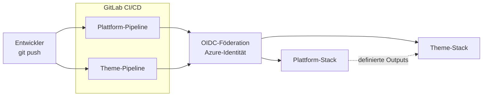

# Cloud-based escape room platform


*Das Image wurde mit Microsoft Copilot erstellt.*

---

# Inhaltsverzeichnis

[[ _TOC_ ]]

---

## 1 Einleitung

In dieser Arbeit wird eine Cloud-basierte Escape-Room-Plattform entwickelt, welche zur interaktiven Vermittlung von IT-Wissen dient. Die Plattform ermöglicht es Lernenden, technische Herausforderungen und Rätsel in einer praxisnahen und spielerischen Umgebung zu lösen. Ziel ist es, theoretische Inhalte aus der IT-Ausbildung mit realitätsnahen Szenarien zu kombinieren und dadurch den Lernerfolg nachhaltig zu verbessern.

Die Plattform basiert auf einer Cloud-nativen Microservice-Architektur und wird im Azure Tenant der Contoso University umgesetzt. Escape Rooms werden automatisiert über GitLab CI/CD Pipelines bereitgestellt und betrieben. Zusätzlich erfolgt die Authentifizierung über Microsoft Entra ID, wodurch eine sichere und kontrollierte Nutzung gewährleistet wird. Die Infrastruktur wird mithilfe von Infrastructure as Code (OpenTofu / Terraform) automatisiert und reproduzierbar bereitgestellt.

Die Arbeit dient als proof of concept (POC) für eine moderne und interaktive Lernplattform im Bereich der IT-Ausbildung. Sofern sich das Konzept bewährt, ist eine Weiterentwicklung mit zusätzlichen Szenarien und Funktionen vorgesehen.

Die Arbeit stützt sich auf das im dritten Semester des Lehrgangs zum dipl. Informatiker HF mit Vertiefung in Cloud Native erarbeitete Fachwissen und wurde von Marlon Burri als Einzelarbeit konzipiert und umgesetzt.

> **Lizenz- und Herkunftshinweis zum Tutorial Room**
> Dieses Repository enthält abgeleitete Inhalte aus dem Repository [`ma-room-template`](https://gitlab.com/solvista/ma-room-template), das unter **Creative Commons Attribution-ShareAlike 4.0 International (CC BY-SA 4.0)** veröffentlicht wurde.
> Betroffen sind insbesondere `frontend/app/templates/tutorial.html`, `backend/app/rooms/tutorial/` sowie die dazugehörigen Dokumentationsabschnitte.
> Eigene Anpassungen umfassen vor allem das UI-/CSS-Redesign, die inhaltliche Contoso-/Cloud-Escape-Lab-Einbettung und projektspezifische Integration in Frontend und Backend.
> Die konkreten Attribution-Hinweise stehen in [`NOTICE`](./NOTICE), der vollständige Lizenztext in [`LICENSE`](./LICENSE).

## 1.1 Behandelte Module

- Microservices mit Python
- Relationale Datenbanken
- Datensicherheit
- Containersicherheit
- Netzwerk
- Projektmanagement
- Infrastructure as Code (IaC)
- Function as a Service (FaaS)
- Microsoft Azure Cloud

---

# Projektorganisation

```mermaid
flowchart TB
  subgraph Projekthierarchie[Projekthierarchie]
    direction TB

    subgraph Lehrgangsleitung
      Lehrgangsleiter[Lehrgangsleiter]
    end

    subgraph Projektbegleitung
      direction LR
      Projektleiter[Projektleiter]
      Fachdozent[Fachdozent]
    end

    subgraph Studierender
      Stud[Marlon Burri]
    end
  end

  Lehrgangsleiter <--> Projektleiter
  Lehrgangsleiter <--> Fachdozent
  Projektleiter <--> Stud
  Fachdozent <--> Stud

  linkStyle default stroke:#94a3b8,stroke-width:1.5px;
  style Projekthierarchie fill:#f8fafc,stroke:#e2e8f0,color:#334155,stroke-width:1px;
  style Lehrgangsleitung fill:#f8fafc,stroke:#dbe2ea,color:#334155,stroke-width:1px;
  style Projektbegleitung fill:#f8fafc,stroke:#dbe2ea,color:#334155,stroke-width:1px;
  style Studierender fill:#f8fafc,stroke:#dbe2ea,color:#334155,stroke-width:1px;

  classDef mentors fill:#f1f5f9,color:#334155,stroke:#cbd5e1,stroke-width:1.5px;
  classDef student fill:#dcfce7,color:#166534,stroke:#86efac,stroke-width:1.5px;

  class Lehrgangsleiter,Projektleiter,Fachdozent mentors;
  class Stud student;
  ```

## 2.1 Problemstellung

In der heutigen IT-Ausbildung werden technische Inhalte häufig theoretisch oder anhand isolierter Übungen vermittelt. Dies erschwert es Lernenden, komplexe Zusammenhänge praxisnah zu verstehen und in realistischen Szenarien anzuwenden.

Zusätzlich erfordern viele technische Themen ein hohes Mass an Eigeninitiative und praktischem Verständnis, welches durch klassische Lernmethoden nur begrenzt gefördert wird. Moderne Lernansätze wie Gamification oder interaktive Challenges gewinnen deshalb zunehmend an Bedeutung.

Mit dieser Arbeit soll eine Cloud-basierte Escape-Room-Plattform entwickelt werden, welche IT-Wissen spielerisch und praxisorientiert vermittelt. Die Plattform kombiniert moderne Cloud-Technologien, Microservices, CI/CD sowie Infrastructure as Code und ermöglicht Lernenden, technische Herausforderungen innerhalb realistischer Szenarien zu lösen.

## 2.2 Aufgabenstellung

Basierend auf der beschriebenen Problemstellung ist das Ziel dieser Arbeit die Entwicklung einer Cloud-basierten Escape-Room-Plattform für die interaktive Vermittlung von IT-Wissen. Die Plattform soll mindestens ein vollständig spielbares Escape-Room-Szenario bereitstellen und eine moderne Cloud-native Architektur verwenden.

Zur Umsetzung wird eine Microservice-Architektur eingesetzt, bei welcher Frontend, Backend und Spiellogik voneinander getrennt entwickelt und betrieben werden. Die Bereitstellung der Plattform erfolgt automatisiert über GitLab CI/CD Pipelines. Zusätzlich wird die Infrastruktur mithilfe von OpenTofu (Terraform) als Infrastructure as Code umgesetzt.

## 2.3 Ziele

- Entwicklung einer funktionalen Cloud-basierten Escape-Room-Plattform mit mindestens einem vollständig spielbaren Szenario
- Umsetzung einer Microservice-Architektur mit getrennten Komponenten für Frontend, Backend und Spiellogik
- Aufbau einer automatisierten CI/CD Pipeline mit GitLab für Build, Testing und Deployment
- Integration einer Authentifizierungslösung mittels Microsoft Entra ID inklusive rollenbasierter Zugriffskontrolle
- Automatisierte Bereitstellung der Infrastruktur mithilfe von OpenTofu (Terraform)
- Implementierung mindestens einer Azure Function zur Verarbeitung von Spielinteraktionen
- Einsatz einer relationalen Datenbank zur Speicherung von Spielständen, Sessions oder Benutzerinformationen
- Erstellung einer vollständigen Projektdokumentation inklusive Architekturübersicht, Deployment-Prozess und Lessons Learned

## 2.4 Sachmittel

Microsoft Azure Portal & CLI
GitLab
Jira (SCRUM-Board)
Visual Studio Code
Docker / Docker Compose
OpenTofu (Terraform)
Microsoft Entra ID
AI-Tools (ChatGPT, Claude, Copilot etc.)
JavaScript / TypeScript
Python
PostgreSQL
Azure Functions

## 2.5 Vorgaben, Methoden und Werkzeuge

__Projektmethodik:__

Für die Umsetzung des Projekts wird SCRUM als agile Projektmanagementmethode eingesetzt. Die Entwicklung erfolgt iterativ in mehreren Sprints, wodurch regelmässig funktionsfähige Zwischenstände entstehen, welche überprüft und bei Bedarf angepasst werden können. Nach jedem Sprint werden Reviews und Retrospektiven durchgeführt, um den aktuellen Projektstand zu evaluieren und das weitere Vorgehen gezielt zu optimieren.

__Projektmanagement:__

Für die Planung, Organisation und Steuerung des Projekts wird Jira eingesetzt. Sämtliche User Stories, Tasks, Sprint-Planungen sowie Fortschritte werden zentral verwaltet, um eine strukturierte und nachvollziehbare Projektorganisation sicherzustellen.

__Versionsverwaltung und Dokumentation:__

GitLab wird für die Versionsverwaltung, Dokumentation sowie die Nachverfolgung sämtlicher Änderungen verwendet. Der gesamte Quellcode, die Infrastrukturdefinitionen sowie die technische Dokumentation werden zentral in einem GitLab-Repository verwaltet.

Die Projektdokumentation erfolgt fortlaufend in Markdown-Dateien innerhalb des Repositories und wird durch Commit Messages ergänzt, um die Nachvollziehbarkeit aller Änderungen sicherzustellen. Zusätzlich wird GitLab CI/CD zur Automatisierung von Build-, Test- und Deployment-Prozessen eingesetzt.

__Systemarchitektur und technische Umsetzung:__

Die Plattform basiert auf einer Cloud-nativen Microservice-Architektur und wird im Azure Tenant der Contoso University umgesetzt. Einzelne Komponenten wie Frontend, Backend, Spiellogik sowie serverlose Funktionen werden voneinander getrennt entwickelt und betrieben, um eine flexible, skalierbare und wartbare Architektur zu gewährleisten.

Das Frontend wird mit JavaScript beziehungsweise TypeScript umgesetzt. Für die Backend- und API-Komponenten wird Python verwendet. Die Kommunikation zwischen den einzelnen Diensten erfolgt über definierte Schnittstellen und APIs.

Die Plattform wird containerisiert betrieben. Dafür werden Docker und Docker Compose eingesetzt, um die einzelnen Services lokal sowie in der Cloud reproduzierbar bereitzustellen.

__Cloud und Infrastruktur:__

Die Bereitstellung der Infrastruktur erfolgt mittels Infrastructure as Code unter Verwendung von OpenTofu (Terraform-kompatibel). Dadurch kann die gesamte Umgebung automatisiert, standardisiert und reproduzierbar bereitgestellt werden.

Das Terraform-Statefile wird zentral in einem Azure Storage Account gespeichert, um eine konsistente Verwaltung der Infrastruktur sicherzustellen. Sämtliche Azure-Ressourcen werden innerhalb des Azure Tenants der Contoso University erstellt und verwaltet.

__CI/CD und Deployment:__

Für die Automatisierung von Build-, Test- und Deployment-Prozessen wird GitLab CI/CD eingesetzt. Änderungen am Quellcode lösen automatisierte Pipelines aus, welche die Container erstellen, testen und anschliessend in die Zielumgebung deployen.

Die Plattform soll so aufgebaut werden, dass Escape-Room-Szenarien automatisiert bereitgestellt und aktualisiert werden können. Dadurch wird ein effizienter und standardisierter Deployment-Prozess ermöglicht.

__Test und Validierung:__

Das Testing erfolgt kontinuierlich während der gesamten Entwicklung. Nach der Implementierung einzelner Funktionen werden Funktions-, Integrations- sowie Deployment-Tests durchgeführt.

Am Ende des Projekts erfolgt zusätzlich ein End-to-End-Test der gesamten Plattform inklusive Authentifizierung, Deployment, Datenhaltung und Spiellogik, um die korrekte Funktionsweise der Lösung sicherzustellen.

__Arbeitsumgebung:__

Die Entwicklung des Projekts erfolgt vollständig auf meinem persönlichen Laptop. Der gesamte Quellcode wird lokal entwickelt und anschliessend in das zentrale GitLab-Repository übertragen.

Als Entwicklungsumgebung wird Visual Studio Code verwendet, da dieser Editor eine effiziente Arbeitsweise mit Erweiterungen für Docker, Git, Python, Azure und OpenTofu ermöglicht.

Zusätzlich werden AI-gestützte Werkzeuge wie ChatGPT, Claude oder GitHub Copilot unterstützend für Recherche, Problemlösung und Codeunterstützung verwendet.

__Nicht Teil des Projektes:__

Die vollständige produktive Einführung der Plattform ist nicht Bestandteil dieser Semesterarbeit. Ziel der Arbeit ist die Entwicklung eines funktionsfähigen Proof of Concept (POC), welcher die technische Machbarkeit sowie die grundlegende Architektur der Lösung demonstriert.

Eine spätere Erweiterung der Plattform mit zusätzlichen Escape-Room-Szenarien, erweiterten Spielmechaniken oder produktiven Betriebsprozessen ist möglich, jedoch nicht Bestandteil dieser Arbeit.

__Risikoanalyse:__

m Rahmen des Projekts wird eine Risikoanalyse durchgeführt, um potenzielle technische sowie organisatorische Risiken frühzeitig zu identifizieren und geeignete Massnahmen zu definieren.

Das Risiko-Level wird anhand der Eintrittswahrscheinlichkeit sowie der möglichen Auswirkungen eines Risikos bewertet. Beide Faktoren werden auf einer Skala von 1 bis 5 eingestuft und anschliessend kombiniert.

Die Eintrittswahrscheinlichkeit beschreibt, wie wahrscheinlich das Eintreten eines Risikos ist. Die Auswirkung beschreibt die möglichen Folgen auf das Projekt bei Eintritt des Risikos.

Das Risiko-Level wird in folgende Kategorien eingeteilt:
* 🔴 __Sehr hoch__ (15–25)
* 🟠 __Hoch__ (10–14)
* 🟡 __Mittel__ (5–9)
* 🟢 __Niedrig__ (1–4)


*Screenshot von meiner Risiko Matrix aus data/RisikoMatrix.xlsx.*

| Risiko-ID | Beschreibung | Wahrscheinlichkeit | Auswirkung | Risiko-Level | Farbe | Massnahmen |
|---|---|---|---|---|---|---|
| R1 | Hohe Komplexität der Architektur erschwert die Umsetzung und Fehlersuche | 4 (hoch) | 4 (hoch) | 16 | 🔴 Sehr hoch | Fokus auf MVP, klare Architektur sowie schrittweise Umsetzung der Kernfunktionen |
| R2 | Zeitlicher Aufwand überschreitet den verfügbaren Rahmen der Semesterarbeit | 4 (hoch) | 4 (hoch) | 16 | 🔴 Sehr hoch | Priorisierung der wichtigsten Funktionen und iterative Umsetzung |
| R3 | Fehler oder Probleme in GitLab CI/CD Pipelines verhindern automatisierte Deployments | 3 (mittel) | 4 (hoch) | 12 | 🟠 Hoch | Schrittweiser Aufbau der Pipeline sowie regelmässige Tests |
| R4 | Probleme bei der Integration von Microsoft Entra ID und Authentifizierung | 3 (mittel) | 4 (hoch) | 12 | 🟠 Hoch | Frühzeitige Implementierung und kontinuierliches Testing der Authentifizierung |
| R5 | Fehlerhafte Infrastrukturdefinitionen in OpenTofu führen zu fehlerhaften Deployments | 3 (mittel) | 3 (mittel) | 9 | 🟡 Mittel | Regelmässige Validierung der Infrastruktur sowie Verwendung separater Testumgebungen |

__SWOT-Analyse:__

Im Rahmen der Konzeptionsphase wurde eine SWOT-Analyse durchgeführt, um die Stärken, Schwächen, Chancen und Risiken des Projekts systematisch zu erfassen. Diese Analyse dient als Grundlage für strategische Entscheidungen im weiteren Verlauf der Arbeit.


*Screenshot von meiner SWOT-Analyse aus data/SWOT_Analyse.xlsx.*


---

# 3 Projektplan

Für die Semesterarbeit wurden vier Sprints geplant. Auf einen klassischen Gantt-Plan wurde bewusst verzichtet, da die Umsetzung agil nach dem SCRUM-Framework erfolgt. Stattdessen wurden die Sprints mit fixen Zeitfenstern und klaren Zielen definiert, um den Fortschritt trotzdem strukturiert verfolgen und steuern zu können.

**Der Zeitplan für die Projektsprints sieht wie folgt aus:**

| Sprint   | Titel                              | Zeitraum                | Ziel                                                                                                                  |
|----------|----------------------------------- |-------------------------|-----------------------------------------------------------------------------------------------------------------------|
| Sprint 0 | Setup und Planung                  | 27.04.2026 – 08.05.2026 | Projektinitialisierung (GitLab, Jira, Azure-Setup, Backlog-Erstellung etc.)                                           |
| Sprint 1 | Core Platform & Game Engine        | 11.05.2026 – 31.05.2026 | Frontend Grundstruktur, Game Engine (State, Actions), erster Escape Room (Tutorial), einfache Interaktionen |
| Sprint 2 | Interaktivität & Cloud Integration | 01.06.2026 – 21.06.2026 | Erweiterte Interaktionen, mehrere Räume / Szenarien, Cloud Deployment (erste Version), Microservices einführen            |
| Sprint 3 | DevOps, Auth & Finalisierung       | 22.06.2026 – 06.07.2026 | Auth mit Microsoft Entra ID, Escape Rooms via GitLab Pipelines starten, Testing, Bugfixing, Dokumentation, Präsentation.                            |

Die folgende Gantt-Übersicht visualisiert die Sprint-Planung und die zugehörigen Releases (MVP, MLP, MMP). Das Diagramm wird direkt im README als Mermaid gepflegt und ist konsistent mit der obigen Tabelle.

```mermaid
gantt
  title Gantt Chart
  dateFormat YYYY-MM-DD
  axisFormat %b '%y

  section Sprints
  Sprint 0 :crit, sprint0, 2025-10-31, 2025-11-06
  Sprint 1 :sprint1, 2025-11-07, 2025-11-27
  Sprint 2 :sprint2, 2025-11-28, 2025-12-18
  Sprint 3 :sprint3, 2025-12-19, 2026-01-08
  Sprint 4 :sprint4, 2026-01-09, 2026-01-28

  section Releases
  MVP :crit, mvp, 2025-11-27, 1d
  MLP :crit, mlp, 2025-12-18, 1d
  MMP :crit, mmp, 2026-01-08, 1d
```

*Gantt‑Übersicht der Sprints und Releases*

## 3.1 Product Roadmap

Die Product Roadmap zeigt die übergeordnete Planung und Entwicklungsrichtung des Projekts über die gesamte Dauer der Semesterarbeit hinweg.
Sie dient als Leitfaden für die Umsetzung der definierten Releases (MVP, MLP, MMP) und ist eng an die Sprint-Struktur des SCRUM-Frameworks angelehnt.
Da das Projekt iterativ aufgebaut ist, können Anpassungen während der Umsetzung jederzeit vorgenommen werden, um flexibel auf neue Erkenntnisse und Herausforderungen zu reagieren.

Sprint 0 und Sprint 4 sind in der Roadmap nicht aufgeführt, da in diesen Sprints kein Produkt bzw. Release entstehen wird.

__Übersicht der Releases:__

| Release                          | Zeitraum (Sprint) | Ziel / Inhalt                | Hauptfokus                                                                                                                  |
|----------------------------------|-------------------|------------------------------|-----------------------------------------------------------------------------------------------------------------------|
| MVP (Minimum Viable Product)     | Sprint 1          | Grundlegende Architektur und Funktionsfähigkeit des automatisierten Bestellprozesses mit Camunda. Einrichtung der Entwicklungsumgebung, Definition der Systemarchitektur und Umsetzung eines lauffähigen Prototyps zur automatisierten Erstellung von Azure Subscriptions. | Funktionsfähigkeit, Architektur, Basisprozess |
| MLP (Minimum Lovable Product)    | Sprint 2          | Erweiterung des MVP um zusätzliche Funktionalitäten, wie erweiterte Governance-Tags, Prozessoptimierungen und Benutzerfreundlichkeit. Der Prozess soll robust und nachvollziehbar sein und sich leicht erweitern lassen. | Nutzerfreundlichkeit, Stabilität, Governance |
| MMP (Minimum Marketable Product) | Sprint 3          | Fertigstellung des Projekts mit Fokus auf Einsatzfähigkeit im Betrieb. Finalisierung der Dokumentation, Tests, Optimierung der Endlösung. | Produktionsreife, Abschluss           |

## 3.2 Definition of Ready (DoR)

Die Definition of Ready (DoR) legt fest, welche Voraussetzungen eine User Story erfüllen muss, damit sie in ein Sprint Backlog aufgenommen werden kann. Ziel der DoR ist es, sicherzustellen, dass User Stories fachlich verstanden, technisch planbar und innerhalb des Sprint-Zeitrahmens realistisch umsetzbar sind.

Im Rahmen dieser Semesterarbeit dient die Definition of Ready zusätzlich als Qualitätskontrolle für die Vorbereitung technischer sowie organisatorischer Aufgaben innerhalb der Cloud-basierten Escape-Room-Plattform.

__Inhaltliche Anforderungen:__
- Die User Story enthält eine verständliche Beschreibung nach dem Scrum-Framework.
- Der fachliche oder technische Mehrwert der Story für das Projekt ist klar ersichtlich.
- Akzeptanzkriterien wurden definiert.
- Die Story unterstützt die Ziele des jeweiligen Releases (MVP, MLP oder MMP).

__Technische Anforderungen:__
- Technische Abhängigkeiten sowie benötigte Ressourcen wurden identifiziert.
- Betroffene Komponenten wie Frontend, Backend, Datenbank oder Cloud-Infrastruktur sind bekannt.
- Risiken, mögliche Blocker oder offene technische Fragen wurden analysiert.
- Falls erforderlich, wurden Vorbereitungen für Infrastruktur, Container oder CI/CD vorgenommen.

__Planbarkeit:__
- Die User Story kann innerhalb eines Sprints realistisch umgesetzt werden.
- Grössere Aufgaben wurden in Subtasks aufgeteilt.
- Story Points wurden anhand der Fibonacci-Folge geschätzt.
- Die Priorisierung der Story wurde festgelegt.
- Die Story wurde im Sprint Planning besprochen und freigegeben.

Die Definition of Ready gilt einheitlich für sämtliche User Stories des Projekts und wird nicht individuell pro Story angepasst.

## 3.3 Definition of Done (DoD)

Die Definition of Done (DoD) beschreibt die Kriterien, welche erfüllt sein müssen, damit eine User Story als vollständig abgeschlossen gilt. Ziel der DoD ist es, eine einheitliche Qualitätssicherung für Entwicklung, Testing, Dokumentation und Deployment sicherzustellen.

__Umsetzung der Anforderungen:__
- Alle definierten Akzeptanzkriterien wurden vollständig umgesetzt.
- Die Funktionalität erfüllt den vorgesehenen fachlichen oder technischen Zweck.
- Der Code wurde erfolgreich implementiert und getestet.

__Validierung und Qualitätssicherung:__
- Funktionale Tests oder manuelle Überprüfungen wurden durchgeführt.
- Fehler oder technische Probleme wurden analysiert und behoben.
- Falls relevant, wurden Container, APIs oder Cloud-Ressourcen erfolgreich getestet.
- Die Lösung funktioniert innerhalb der vorgesehenen Entwicklungs- oder Cloud-Umgebung.

__Dokumentation und Nachvollziehbarkeit:__
- Wichtige technische Entscheidungen sowie Umsetzungsschritte wurden dokumentiert.
- Änderungen im GitLab-Repository sind nachvollziehbar versioniert.
- Die zugehörigen Commits und Merge Requests sind mit Jira verknüpft.
- Relevante Anpassungen an Infrastruktur oder Deployment-Prozessen wurden dokumentiert.

__Integration und Abschluss:__
- Die User Story wurde erfolgreich in das Gesamtprojekt integriert.
- Falls relevant, wurde die CI/CD-Pipeline erfolgreich durchlaufen.
- Die Story wurde im Sprint Review präsentiert und akzeptiert.
- Der Status der Story wurde in Jira auf Done gesetzt.

Im Jira-Projekt ist eine Automation Rule hinterlegt, welche beim Erstellen neuer User Stories automatisch die wichtigsten DoD-Kriterien ergänzt. Dadurch wird sichergestellt, dass sämtliche Stories nach denselben Qualitätsstandards umgesetzt und überprüft werden.

## 3.4 Projektsprints und Releases

### 3.4.2 Sprint 1 – MVP Release

__Sprint Planning:__

**Zeitplan:**
11.05.2026 – 31.05.2026

**Beschreibung:**
Der erste produktive Sprint dient der Umsetzung eines Minimum Viable Product (MVP) der Escape-Room-Plattform. Im Rahmen dieses Sprints werden die grundlegende Plattformarchitektur definiert, die Basisstruktur der Anwendung aufgebaut sowie ein erster spielbarer Escape Room entwickelt. Die erarbeiteten Komponenten bilden die technische Grundlage für die Weiterentwicklung der Plattform in den folgenden Sprints. Nach Vollendung des Sprints steht ein funktionaler Prototyp mit ersten Interaktionsmöglichkeiten zur Verfügung.

**Meilenstein:** MVP mit grundlegender Plattformarchitektur und erstem spielbaren Escape Room umgesetzt.

__Sprint Review:__

**Status:**
Der Sprint wurde erfolgreich abgeschlossen. Der definierte Meilenstein wurde erreicht und sämtliche geplanten User Stories konnten innerhalb des vorgesehenen Zeitraums umgesetzt werden.

**Übersicht des Backlogs:**
Die folgenden Aufgaben wurden innerhalb des Sprints geplant, bearbeitet und erfolgreich abgeschlossen:

* [S3M-6, Define project structure and architecture]()✅-DONE
* [S3M-12, Define CI/CD pipeline concept]()✅-DONE
* [S3M-13, Basic Frontend UI]()✅-DONE
* [S3M-14, Game State Management]()✅-DONE
* [S3M-15, Tutorial Escape Room]()✅-DONE
* [S3M-16, Interaction System]()✅-DONE
* [S3M-17, Feedback System]()✅-DONE
* [S3M-19, Define Project Documentation]()✅-DONE

**Risikoverlauf:**

Die nachfolgende Tabelle zeigt den Stand aller Risiken aus der initialen Risikoanalyse am Ende von Sprint 1.

| Risiko-ID | Beschreibung | Score vorher | Score nachher | Status | Bemerkung |
|-----------|--------------|:------------:|:-------------:|:------:|-----------|
| R1 | Hohe Komplexität der Architektur erschwert die Umsetzung und Fehlersuche | 🔴 16 | 🟠 12 | ↓ | MVP erfolgreich umgesetzt; schrittweise Umsetzungsstrategie bewährt sich. Eintrittswahrscheinlichkeit sinkt von 4 auf 3. |
| R2 | Zeitlicher Aufwand überschreitet den verfügbaren Rahmen der Semesterarbeit | 🔴 16 | 🔴 16 | → | Sprint-Ziele erreicht, jedoch hat das Erkunden von GitLab-Plattform-Features mehr Zeit gekostet als geplant. Risiko bleibt unverändert hoch. |
| R3 | Fehler oder Probleme in GitLab CI/CD Pipelines verhindern automatisierte Deployments | 🟠 12 | 🟡 8 | ↓ | Lint-Pipeline (ruff, tflint, hadolint, trivy) sowie terraform validate eingeführt. Pipeline wird auf MRs automatisch ausgeführt. Eintrittswahrscheinlichkeit sinkt von 3 auf 2. |
| R4 | Probleme bei der Integration von Microsoft Entra ID und Authentifizierung | 🟠 12 | 🟠 12 | → | Entra ID Integration ist erst für Sprint 3 geplant; noch nicht adressiert. Zusätzliche Erkenntnis: Azure FIC-Wildcard matcht keine Schrägstriche – Branch-Benennung auf Bindestriche (`feature-xyz`) umgestellt, um OIDC-Auth-Fehler zu verhindern. |
| R5 | Fehlerhafte Infrastrukturdefinitionen in OpenTofu führen zu fehlerhaften Deployments | 🟡 9 | 🟡 6 | ↓ | tflint und terraform validate sind in der Pipeline integriert. Infrastruktur noch nicht deployed (Pipeline auf `when: never`); Eintrittswahrscheinlichkeit sinkt von 3 auf 2. |

__Sprint Retrospective:__

Für die Retrospektive habe ich wie im vergangenen Semester die Mad, Sad, Glad Methode auf einem Miro-Board angewendet. Sie erlaubt eine kompakte, ehrliche Einschätzung des Sprints aus drei verschiedenen Blickwinkeln.


*Screenshot vom Miro Board für die Retrospektive des Sprint 1.*

**Lessons Learned:**

- **GitLab Managed Terraform State von Anfang an nutzen:** Der Self-managed Remote State im Azure Storage Account hat den Bootstrap-Code unnötig vergrössert. Mit dem GitLab-integrierten Backend wäre der Bootstrap etwa halb so gross – und die Pipeline-Konfiguration für State-Locking deutlich einfacher.
- **Branch-Namenskonvention beachten (Bindestriche statt Schrägstriche):** Azure Managed Identity Federated Identity Credentials erlauben keinen Wildcard-Match über `/`. Ein Branch `feature/xyz` würde in der OIDC-Pipeline nie authentifiziert werden. Die Konvention `feature-xyz` löst dieses Problem vollständig.
- **Plattform-Features gezielt einführen, nicht explorativ:** GitLab bietet viele nützliche Features (Pages, Releases, Cleanup Policies). Die explorative Herangehensweise hat jedoch deutlich mehr Zeit gekostet als geplant. In zukünftigen Sprints werden Platform-Features als explizite User Stories geplant, damit der Aufwand sichtbar und steuerbar bleibt.
- **Linting früh in der Pipeline verankern zahlt sich aus:** Die frühe Integration von ruff, tflint, hadolint und Trivy verhindert das Einschleichen von Code-Smells und Sicherheitsproblemen. Einmal eingerichtet, läuft die Pipeline wartungsarm und liefert konsistenten Mehrwert.


### 3.4.3 Sprint 2 – MLP Release

__Sprint Planning:__

**Zeitplan:**
01.06.2026 – 21.06.2026

**Beschreibung:**
Der Sprint 2 dient der Weiterentwicklung des bestehenden MVPs hin zu einem Minimum Lovable Product (MLP). Im Rahmen dieses Sprints wird die Cloud-Infrastruktur sowie die Implementierung einer durchgängigen Deployment-Pipeline für die Escape-Room-Plattform aufgebaut. Ziel ist eine robustere, besser strukturierte und leichter erweiterbare Gesamtarchitektur.

Meilenstein: Erweiterte interaktive Escape-Room-Plattform mit mehreren Szenarien, erster Cloud-Deployment-Version und initialer Microservice-Architektur umgesetzt.

__Sprint Review:__

Abgeschlossene User Stories:

__Risikoverlauf Sprint 2:__

__Sprint Retrospective:__

__Lessons Learned:__


### 3.4.4 Sprint 3   – MMP Release

__Sprint Planning:__

__Sprint Review:__

Abgeschlossene User Stories:

__Risikoverlauf Sprint 3:__

__Sprint Retrospective:__

__Lessons Learned:__

---

# 4 Lösungsdesign

Zu Beginn des Projekts wurden die grundlegenden Rahmenbedingungen für die technische Umsetzung definiert. Dabei standen insbesondere die Engineering-Prinzipien, das Delivery-Modell sowie die Zielarchitektur in Azure im Fokus. Ziel ist eine wartbare, sichere und erweiterbare Plattform, welche die Entwicklung und den Betrieb mehrerer Escape-Room-Szenarien unterstützt.

## 4.1 Arbeitsweise und Engineering-Prinzipien

Die Umsetzung folgt einem Engineering-Ansatz, bei dem Infrastruktur, Anwendungscode und Deployment als integriertes Gesamtsystem betrachtet werden. Änderungen sollen reproduzierbar, nachvollziehbar und mit minimalem manuellem Aufwand ausgerollt werden können.

Daraus ergeben sich folgende Grundprinzipien:

- **Infrastructure as Code (IaC):** Sämtliche Azure-Ressourcen werden deklarativ beschrieben, versioniert und automatisiert bereitgestellt.
- **Automation First:** Nach der initialen Einrichtung erfolgen Änderungen ausschliesslich über definierte CI/CD-Prozesse anstelle manueller Anpassungen im Azure-Portal.
- **Security by Design:** Die Authentifizierung gegenüber Azure-Diensten erfolgt über Managed Identities und Microsoft Entra ID. Dadurch können statische Zugangsdaten vermieden und Sicherheitsrisiken reduziert werden.

Diese Prinzipien stellen sicher, dass Änderungen nachvollziehbar bleiben, Deployments konsistent durchgeführt werden und der Betriebsaufwand auch bei wachsendem Projektumfang beherrschbar bleibt.

## 4.2 Lösungsdesign in Azure

Das Azure-Design trennt bewusst zwischen einer stabilen Plattform und fachlich wechselnden Escape-Room-Inhalten. Shared Services werden zentral bereitgestellt, während einzelne Themes unabhängig erweitert und ausgerollt werden können. Dadurch bleibt die Basis stabil, auch wenn sich der fachliche Inhalt regelmässig verändert.

Vor dem regulären Betrieb ist ein einmaliger Bootstrap notwendig. Dabei werden das Terraform State Backend und die Identität für die Authentifizierung gegenüber Azure vorbereitet. Danach laufen alle weiteren Änderungen automatisiert über den definierten CI/CD-Workflow.

| Ebene | Rolle im Lösungsdesign |
|---|---|
| **Bootstrap** | Schafft die technischen Voraussetzungen für automatisierte Deployments |
| **Plattform-Stack** | Enthält die gemeinsame Azure-Basis wie Netzwerk, Security, Persistenz und zentrale Plattformdienste |
| **Theme-Stack** | Kapselt einen einzelnen Escape Room mit seinen themenspezifischen Ressourcen |

Entscheidend ist, dass Theme-Stacks nur definierte Outputs des Plattform-Stacks verwenden, diesen aber nicht verändern. Dadurch lassen sich neue Inhalte ergänzen, ohne die Gesamtarchitektur oder bestehende Deployments zu destabilisieren.

### 4.2.1 Big Picture

Das Big Picture zeigt in erster Linie, wie die Lösung in Azure aufgebaut ist. Im Fokus stehen die zentralen Plattformkomponenten, ihre Abhängigkeiten sowie der eingehende und ausgehende Traffic Flow zwischen den beteiligten Services. Damit macht die Darstellung sichtbar, über welche Entry Points Requests in die Plattform gelangen, wie sie intern weitergeleitet werden und welche Komponenten für ausgehende Kommunikation zuständig sind.

Im Zentrum steht der Plattform-Stack als gemeinsame Basis. Er bündelt die wiederverwendbaren Foundation-Services, auf die die einzelnen Escape-Room-Themes aufbauen. Die Theme-Stacks ergänzen darauf ihre eigenen Workloads, ohne die gemeinsame Basis zu verändern. Dadurch entsteht eine modulare Architektur mit klaren Verantwortlichkeiten, sauber getrennten Zuständigkeiten und einem nachvollziehbaren Routing- und Security-Modell.


*Big Picture der Azure-Zielarchitektur inklusive Ingress- und Egress-Flow*

### 4.2.2 Delivery-Flow



## 4.3 Gitflow und Delivery-Modell

Für die tägliche Arbeit wird ein schlankes Gitflow-Modell eingesetzt. `main` bleibt jederzeit in einem stabilen und releasefähigen Zustand. Neue Features, Fixes und Hotfixes werden isoliert in eigenen Branches umgesetzt und erst nach Review integriert.

```
main
 ├── feature/<beschreibung>
 ├── fix/<beschreibung>
 └── hotfix/<beschreibung>
```

Der Merge nach `main` erfolgt ausschliesslich über Merge Requests. So bleibt jede Änderung nachvollziehbar und durchläuft vor der Integration die definierten Quality Gates. Die Pipeline fungiert dabei als technisches Merge-Gate und prüft Codequalität, Security, Build-Fähigkeit und geplante Infrastrukturänderungen, bevor ein Merge oder Deployment möglich ist.

Releases werden zusätzlich über Tags markiert, damit wichtige Projektstände wie MVP, MLP und MMP eindeutig referenzierbar bleiben. Das unterstützt einen klaren Release-Stand, kontrollierte Integration und eine saubere Nachvollziehbarkeit über den gesamten Lifecycle.

---

# 5 Umsetzung

Dieses Kapitel beschreibt die technische Umsetzung der deployte Plattformarchitektur. Im Fokus stehen die konkreten Implementierungsentscheide, ihre Begründung und das Zusammenspiel der beteiligten Komponenten. Die Darstellung folgt dem natürlichen Ablauf: vom einmaligen Bootstrap über die Infrastrukturbereitstellung und die CI/CD-Pipeline bis hin zum Routing und der Netzwerkanbindung.

## 5.1 Erstmaliges Deployment (Bootstrap)

Der Bootstrap-Prozess löst ein strukturelles Henne-Ei-Problem, das bei vollständig codegetriebenen CI/CD-Setups mit Remote-State unvermeidbar auftritt: Die GitLab-Pipeline benötigt für das Deployment via OIDC eine Managed Identity sowie ein Remote-State-Backend in Azure — beides existiert jedoch erst nach einem erstmaligen, manuell ausgelösten Deployment.

Die Lösung besteht in einem einmaligen, lokal ausgeführten `terraform apply` des Bootstrap-Stacks (`bootstrap/`). Dieser Stack ist bewusst vom automatisierten Pipeline-Prozess entkoppelt und darf nach der Ersteinrichtung nicht mehr verändert werden. Er erstellt ausschliesslich die folgenden Infrastrukturgrundlagen:

| Ressource | Zweck |
|---|---|
| Azure Storage Account `sttfstatescape` | Remote-Backend für alle Terraform-State-Dateien |
| User-Assigned Managed Identity `mi-maker` | OIDC-Identität für die GitLab CI/CD-Pipeline |
| OIDC Federated Identity Credential | Verknüpft die GitLab-Pipeline mit der Azure-Identität über Entra ID |

Nach erfolgreichem Bootstrap verfügt die Pipeline über eine vertrauenswürdige Azure-Identität und einen stabilen State-Speicher. Ab diesem Zeitpunkt übernimmt der automatisierte CI/CD-Prozess alle weiteren Infrastrukturveränderungen.

### Kaltstart der Container Images

Ein zweites strukturelles Problem ergibt sich beim allerersten `terraform apply` des Platform-Stacks: Azure Container Apps referenzieren bei ihrer Erstellung ein Container-Image aus der ACR, das zu diesem Zeitpunkt noch nicht existiert. Terraform bricht den Vorgang in diesem Fall ab, da die referenzierte Ressource nicht auflösbar ist.

Um diesen Kaltstart zu ermöglichen, werden die Container-Images für Frontend und Backend einmalig manuell gebaut und in die ACR gepusht, bevor das IaC zum ersten Mal ausgeführt wird. Dafür wird `az acr build` eingesetzt, das den Build-Vorgang direkt in der Azure Cloud-Umgebung ausführt — eine lokale Container-Runtime ist nicht erforderlich:

```bash
az acr build --registry acrlabprodescape --image frontend:bootstrap ./frontend/
az acr build --registry acrlabprodescape --image backend:bootstrap ./backend/
```

Nach diesem einmaligen Schritt werden Images ausschliesslich über die GitLab-Pipeline erstellt und mit einem Commit-SHA als Tag versioniert. Das `bootstrap`-Tag dient ausschliesslich als Platzhalter für die Erstkonfiguration.

### Übergang zum automatisierten Betrieb

Der Bootstrap gliedert sich in drei klar abgegrenzte Phasen:

| Phase | Ausführung | Inhalt |
|---|---|---|
| 1 – Bootstrap | Lokal, einmalig | `bootstrap/` terraform apply — erstellt State-Backend und OIDC-Identität |
| 2 – Kaltstart | Lokal, einmalig | Initiale Container-Images in ACR pushen, danach `infra/` terraform apply |
| 3 – Automatisierter Betrieb | GitLab CI/CD, dauerhaft | Quality Gates → terraform apply → Image build & push → Image-Tag-Update |

Mit Abschluss von Phase 2 ist kein manueller Eingriff mehr für das Deployment von Änderungen notwendig.

## 5.2 Infrastructure as Code mit OpenTofu

Die gesamte Azure-Infrastruktur wird deklarativ mit OpenTofu beschrieben, das zur Terraform-CLI kompatibel ist und unter einer freien Lizenz steht. Die Wahl von OpenTofu gegenüber dem proprietären Terraform CLI folgt dem Open-Source-First-Prinzip und vermeidet Abhängigkeiten von lizenzbezogenen Einschränkungen.

### State-Trennung

Der Infrastrukturcode ist in drei unabhängige Stacks mit je eigenem Remote-State in Azure Blob Storage aufgeteilt:

```
bootstrap/   → key: bootstrap/terraform.tfstate    (lokal, einmalig)
infra/        → key: platform/terraform.tfstate     (Plattform-Pipeline)
themes/<n>/   → key: themes/<n>/terraform.tfstate   (Theme-Pipeline)
```

Diese Trennung ist architektonisch begründet: Platform- und Theme-Stacks haben unterschiedliche Release-Kadenz und klar abgegrenzte Zuständigkeiten. Ein Theme-Deployment berührt die stabile Plattform nicht; ein Platform-Upgrade destabilisiert keine laufenden Themes. Isolierte State-Dateien stellen sicher, dass Deployments vollständig entkoppelt und parallel ausführbar sind.

### Modulstruktur des Platform-Stacks

Der Platform-Stack (`infra/`) ist in klar abgegrenzte Terraform-Module gegliedert:

| Modul | Enthaltene Ressourcen |
|---|---|
| `network` | Subnets `snet-aca` (delegiert an `Microsoft.App/environments`) und `snet-pe`, NSGs |
| `acr` | Azure Container Registry (`acrlabprodescape`, Basic SKU) |
| `aca_env` | Container App Environment `cae-lab-prod-escape` (internal LB, VNet-integriert) |
| `aca_app` | Container App Instanzen für Frontend und Backend |

Jedes Modul exponiert ausschliesslich die Outputs, die von anderen Modulen oder von der Pipeline benötigt werden. Intern bleibt die Implementierung gekapselt, sodass einzelne Module refaktoriert werden können, ohne State-Abhängigkeiten zu gefährden.

### Deployte Azure-Ressourcen

Die folgende Übersicht zeigt den aktuell deployte Plattformzustand:

| Ressource | Name | Kenndaten |
|---|---|---|
| Container App Environment | `cae-lab-prod-escape` | Internal LB, `public_network_access: Disabled`, statische IP `10.20.18.156` |
| Container App (Frontend) | `ca-lab-prod-escape-frontend` | Port 8000, HTTP, System-Assigned MI, min 1 / max 3 Replicas |
| Container App (Backend) | `ca-lab-prod-escape-backend` | Port 5001, HTTP, System-Assigned MI, min 1 / max 1 Replica |
| Container Registry | `acrlabprodescape` | Basic SKU, Image Pull via System-Assigned MI |
| Log Analytics Workspace | `law-lab-prod-escape` | Retention 30 Tage |
| Private DNS Zone | `examplepebble-00000000.northeurope.azurecontainerapps.io` | A-Records `@` und `*` → `10.20.18.156`, VNet-linked |
| Subnet ACA | `snet-aca`, `10.20.18.128/27` | Delegiert an `Microsoft.App/environments` |
| Subnet PE | `snet-pe`, `10.20.18.192/27` | Für zukünftige Private Endpoints |

Die Private DNS Zone wird von OpenTofu automatisch beim Erstellen des Container App Environments ausgelesen und im Spoke-VNet verankert. Die A-Records `@` und `*` zeigen beide auf die statische IP des internen Load Balancers, sodass alle Container App FQDNs innerhalb des VNets auflösbar sind.

## 5.3 CI/CD-Pipeline

Die GitLab CI/CD-Pipeline automatisiert den gesamten Delivery-Prozess vom Code-Commit bis zum produktiven Deployment in Azure.

### Pipelinestruktur

Entsprechend der Trennung von Platform- und Theme-Stacks existieren zwei unabhängige Pipelines, die über `changes:`-Regeln selektiv ausgelöst werden:

**Plattform-Pipeline** (ausgelöst durch Änderungen in `infra/`, `frontend/`, `backend/`):

| Stage | Inhalt |
|---|---|
| Quality Gates | `ruff` (Python-Linting), `tflint`, `terraform fmt/validate`, `hadolint` (Dockerfile), `trivy` (Security-Scan) |
| IaC | `terraform apply infra/` — Infrastrukturänderungen am Platform-Stack |
| Build | Build und Push von Frontend- und Backend-Images mit Commit-SHA-Tag in die ACR |
| Deploy | `terraform apply infra/` — Aktualisierung der Image-Tag-Referenz in den Container Apps |

**Theme-Pipeline** (ausgelöst durch Änderungen in `themes/<name>/`):

| Stage | Inhalt |
|---|---|
| Build | Build und Push des Theme-Images in die ACR |
| IaC | `terraform apply themes/<name>/` — Deployment des Theme-Stacks |

Das abschliessende `terraform apply` der Plattform-Pipeline aktualisiert ausschliesslich die Image-Tag-Referenz. Container App Revisions in Azure werden dabei automatisch erstellt, da jede Image-Tag-Änderung eine neue Revision auslöst.

### Passwortlose Authentifizierung via OIDC

Die Pipeline authentifiziert sich gegenüber Azure über OpenID Connect (OIDC) ohne statische Credentials. Für jede Pipeline-Ausführung stellt GitLab ein kurzlebiges OIDC-Token aus. Die Managed Identity `mi-maker` ist via Federated Identity Credential so konfiguriert, dass sie ausschliesslich Tokens von GitLab.com mit passenden Branch-Namen akzeptiert.

Dabei ist zu beachten: Azure Federated Identity Credentials erlauben keinen Wildcard-Match über `/`-Zeichen in Branch-Namen. Ein Branch `feature/xyz` würde die OIDC-Authentifizierung stillschweigend fehlschlagen lassen. Die Projekt-Konvention `feature-xyz` (Bindestrich statt Schrägstrich) ist deshalb eine direkte technische Anforderung dieser Azure-seitigen Einschränkung — keine rein stilistische Entscheidung.

### Quality Gates als technisches Merge-Gate

Die Quality-Stage ist als Pflichtvoraussetzung für jeden Merge Request nach `main` definiert. Ein Merge ist erst möglich, wenn alle Checks grün sind. Dies verhindert, dass syntaktisch fehlerhafter Terraform-Code, Container-Images mit kritischen CVEs oder Python-Code unterhalb des definierten Qualitätsniveaus in den Hauptbranch gelangen. Die Linter — `ruff`, `tflint`, `hadolint` und `trivy` — wurden bewusst früh im Sprint integriert, um Qualitätsprobleme bereits auf Entwicklerebene zu erkennen, bevor sie die Azure-Umgebung erreichen.

## 5.4 Öffentlicher Zugriff, DNS und Routing

### Architektonische Einordnung

Der öffentliche Zugriff auf die Plattform erfolgt ausschliesslich über den zentralen Application Gateway WAFv2 in der Hub-Subscription der Contoso. Dieses Hub-and-Spoke-Modell hat drei direkte Auswirkungen auf das Projekt:

- **Governance:** TLS-Zertifikate, WAF-Policies und Firewall-Regeln werden von Contoso zentral verwaltet. Das Projekt muss diese Aspekte nicht selbst betreiben.
- **Security:** Die WAF mit OWASP CRS schützt vor häufigen Angriffsvektoren, ohne eine eigene WAF-Konfiguration im Spoke zu erfordern.
- **Einschränkung:** Das Projekt hat keinen direkten schreibenden Zugriff auf die Application-Gateway-Konfiguration. Neue Routing-Einträge werden einmalig pro Theme via Change Request an Contoso beantragt.

### DNS-Konfiguration

Der Hostname `escape.contoso.example` ist im Contoso-internen DNS (IPAM) als CNAME-Eintrag eingetragen, der auf den öffentlichen DNS-Namen des Application Gateways zeigt. Dieser Schritt liegt ausserhalb der automatisierten Infrastruktur und wurde einmalig manuell über ein Change Request an Contoso vorgenommen.

### TLS-Terminierung und internes Routing

Das Application Gateway terminiert TLS am Edge mit dem zentral verwalteten Wildcard-Zertifikat `*.contoso.example`. Die interne Verbindung vom Application Gateway zu den Container Apps im Spoke erfolgt über **HTTP auf Port 80**. TLS-Terminierung geschieht ausschliesslich am Edge; innerhalb des Hub-VNets ist der Traffic unverschlüsselt, da er nie das Netzwerkperimeter verlässt.

Das Application Gateway löst die Container App FQDNs über die Private DNS Zone im Spoke auf:

```
escape.contoso.example  →  CNAME  →  AppGW Public FQDN (Hub)
  AppGW → Private DNS → examplepebble-00000000.northeurope.azurecontainerapps.io
    @ / * → 10.20.18.156 (ACA internal LB)
      ├─ frontend FQDN → ca-lab-prod-escape-frontend (Port 8000)
      └─ backend FQDN  → ca-lab-prod-escape-backend  (Port 5001)
```

### Path-basiertes Routing

Auf dem Listener `escape.contoso.example:443` leitet das Application Gateway Anfragen anhand des URL-Pfads an die zuständige Container App weiter:

| URL-Pfad | Ziel | Backend |
|---|---|---|
| `/` und alle übrigen Pfade | Frontend Container App | `ca-lab-prod-escape-frontend`, HTTP:80 |
| `/tutorial-room`, `/tutorial-room/*` | Backend Container App | `ca-lab-prod-escape-backend`, HTTP:80 |

Der Health-Check-Probe des Application Gateways trifft auf `/healthz` der Frontend Container App.

Das Frontend Container App ist mit `BACKEND_URL = "https://escape.contoso.example"` konfiguriert. API-Requests des Frontends an das Backend laufen damit über den öffentlichen Hostnamen und werden vom Application Gateway erneut geroutet — ein pragmatischer Ansatz für den POC, der eine direkte interne Service-to-Service-Kommunikation noch nicht voraussetzt.

## 5.5 Managed Identity und ACR-Zugriff

Beide Container Apps verwenden eine **System-Assigned Managed Identity**, über die sie Container-Images direkt aus der ACR beziehen. Die Managed Identity erhält auf der ACR die Rolle `AcrPull`, die ausschliesslich das Lesen und Pullen von Images erlaubt — keine Write-Rechte. Statische Zugangsdaten für die Registry sind damit vollständig eliminiert.

```
Container App (System MI)
  └─ AcrPull-Rollenzuweisung
       └─ acrlabprodescape.azurecr.io
            ├─ frontend:bootstrap  (Kaltstart)
            └─ frontend:<sha>      (CI/CD-Betrieb)
```

Dieses Muster gilt identisch für die Backend Container App. Die Rollenzuweisungen werden durch OpenTofu als `azurerm_role_assignment`-Ressourcen verwaltet und sind damit reproduzierbar und auditierbar.

---

# 6 Testverfahren

---

# 7 Projektabschluss

## 7.1 Abschliessende Risikobilanz

## 7.2 Technisches Fazit

## 7.3 Persönliches Fazit

## 7.4 Mögliche Weiterentwicklung

---

# 8 Schlusswort

## 8.1 Quellenverzeichnis

## 8.2 Glossar
