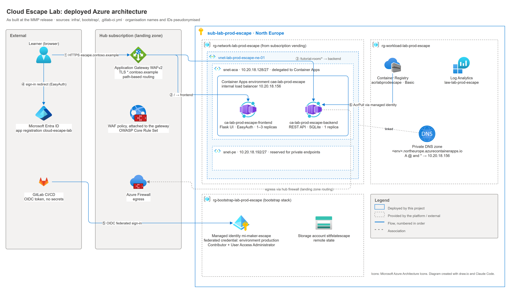

# Architecture

## Principles

Infrastructure, application code and deployment are treated as one system. Every change should be reproducible, traceable and rolled out with as little manual work as possible.

- **Infrastructure as Code:** all Azure resources are described declaratively, versioned and deployed automatically.
- **Automation first:** after the initial bootstrap, changes go through the CI/CD pipeline only, never through the portal.
- **Security by design:** services authenticate with managed identities and Microsoft Entra ID; there are no static credentials.

## Solution design

The design separates a stable platform from escape room content that changes often. Shared services are provided once, while individual rooms ("themes") can be added and rolled out independently.

| Layer | Role |
|---|---|
| Bootstrap | One-off prerequisites for automated deployments: state backend, OIDC identity, Entra app registration |
| Platform stack | Shared Azure foundation: network, registry, Container Apps environment, security |
| Theme stack | One escape room with its own resources |

Theme stacks consume outputs of the platform stack but never change it. New content can therefore be added without destabilising the platform or existing deployments. In the current implementation, the tutorial room runs inside the platform stack; separate theme stacks are a planned extension.

## Azure target architecture



*Deployed architecture, created with draw.io; icons: Microsoft Azure Architecture Icons.*

The escape room subscription is a spoke in an existing hub-and-spoke landing zone (the connectivity subscription was built separately and is not part of this project). The landing zone enforces that all spoke traffic passes either the Web Application Firewall (HTTP/HTTPS) or the Azure Firewall, inbound and outbound, and policies prevent public endpoints on workloads. The draw.io source is in [`diagrams/`](diagrams/).

### Container runtime: Azure Container Apps

Frontend and backend run in an **Azure Container Apps environment** instead of AKS or an App Service plan:

- **No cluster operations:** Azure manages nodes, control plane and patching. For two containers, running an AKS cluster would be disproportionate.
- **Consumption-based scaling:** apps scale between `min_replicas` and `max_replicas` and cost almost nothing when idle, without sizing node pools.
- **VNet integration with an internal load balancer:** all traffic stays private and is routed through the central Application Gateway.
- **Managed identity and native ACR pull:** system-assigned identities pull images without extra configuration.

AKS would offer more control (network policies, sidecars, fine-grained autoscaling) and becomes the better choice with many more workloads or needs such as a service mesh or StatefulSets. For two simple web containers, its fixed node costs, patching effort and required Kubernetes know-how outweigh those benefits.

| Resource | Name | Configuration |
|---|---|---|
| Container Apps environment | `cae-lab-prod-escape` | Internal load balancer, VNet-integrated, static IP `10.20.18.156` |
| Container app (frontend) | `ca-lab-prod-escape-frontend` | Port 8000, system-assigned identity, 1–3 replicas |
| Container app (backend) | `ca-lab-prod-escape-backend` | Port 5001, system-assigned identity, 1 replica |
| Container registry | `acrlabprodescape` | Basic SKU, pull via managed identity |
| Log Analytics workspace | `law-lab-prod-escape` | 30 days retention |
| Subnets | `snet-aca` `10.20.18.128/27`, `snet-pe` `10.20.18.192/27` | Container Apps delegation, reserved for private endpoints |

## Public access, DNS and routing

### Hub-and-spoke ingress

Public access is only possible through the **Application Gateway WAFv2** in the hub subscription. This has three consequences:

- **Governance:** TLS certificates, WAF policies and firewall rules are managed centrally; the project does not operate them.
- **Security:** the OWASP Core Rule Set protects against common attacks without a separate WAF in the spoke.
- **Constraint:** the project has no write access to the gateway; new routes are requested once per theme via change request.

### DNS and TLS

`escape.contoso.example` is a CNAME to the public DNS name of the Application Gateway. The gateway terminates TLS with a central wildcard certificate (`*.contoso.example`) and forwards to the spoke over HTTPS. Backend pools point to internal host names; for the TLS handshake the gateway overrides the host header with the container app FQDN, which it resolves through the private DNS zone in the spoke.

```text
escape.contoso.example  →  CNAME  →  Application Gateway (hub)
  backend pool frontend  →  ca-lab-prod-escape-frontend.<environment>.northeurope.azurecontainerapps.io
  backend pool backend   →  ca-lab-prod-escape-backend.<environment>.northeurope.azurecontainerapps.io
```

### Path-based routing

| Path | Target |
|---|---|
| `/` and all other paths | Frontend container app |
| `/tutorial-room`, `/tutorial-room/*` | Backend container app |

The gateway's health probes use `/tutorial-room/ping` on the backend and `/healthz` on the frontend. `/healthz` is excluded from authentication and returns `200 {"status":"ok"}`.

## Managed identity and registry access

Both container apps use a **system-assigned managed identity** with the `AcrPull` role on the registry: read-only access, no registry passwords. Role assignments are managed by OpenTofu and are therefore reproducible and auditable.

```text
Container app (system-assigned identity)
  └─ AcrPull role assignment
       └─ acrlabprodescape.azurecr.io
            ├─ frontend:bootstrap   (first start)
            └─ frontend:<sha>       (images built by the pipeline)
```

## Authentication with Entra ID (EasyAuth)

The frontend is protected by **Azure Container Apps built-in authentication** (EasyAuth v2). Unauthenticated requests are redirected to the Microsoft sign-in page; only members of the organisation's tenant can sign in, and audience validation (`api://<client_id>`) ensures that only tokens issued for this application are accepted. The configuration lives in [`infra/modules/aca_auth`](../infra/modules/aca_auth).

### Why `azapi` instead of `azurerm`

EasyAuth is configured through the ARM sub-resource `Microsoft.App/containerApps/authConfigs/current`. The `azurerm` provider does not expose it, and every `PUT` it sends for the container app resets the authentication settings. The module therefore uses the `azapi` provider:

| Resource | Purpose |
|---|---|
| `azapi_resource.auth_config` | Creates or updates `authConfigs/current` |
| `azapi_update_resource.app_secret` | Patches the Entra client secret into the app's secrets without overwriting other fields |
| `terraform_data.revision_trigger` + `replace_triggered_by` | Re-applies EasyAuth when the frontend deployment changes, based on a stable hash of the desired configuration |

The re-apply is deliberately not tied to the revision name Azure assigns at runtime: it can change during `apply` and cause *Provider produced inconsistent final plan*. The container app also sets `lifecycle { ignore_changes = [secret] }` so the secret managed by EasyAuth is not removed on the next apply.

### Redirect URIs behind a reverse proxy

The Application Gateway rewrites the `Host` header to the internal container app FQDN. EasyAuth builds the OAuth2 `redirect_uri` from that header, so Entra ID received an address that is not reachable from the browser (`AADSTS50011` / `AADSTS900971`).

**Solution:** a rewrite rule on the gateway injects `X-Forwarded-Host: escape.contoso.example`, and EasyAuth is configured with `forwardProxy.convention = "Standard"` to use it. The callback URL becomes `https://escape.contoso.example/.auth/login/aad/callback`. The gateway module was extended with an `inject_request_headers` option for this.

Two further details: Application Gateway v2 does **not** add `X-Original-Host` automatically (only `X-Forwarded-For`, `-Proto` and `-Port`), and once EasyAuth was active, `/` answered health probes with `302`, which marked the backend unhealthy and returned `502` to all users. Excluding `/healthz` from authentication and pointing the probe there solved it.

## Application

| Component | Description |
|---|---|
| [Frontend](../frontend/README.md) | Flask app with server-side Jinja2 templates; the tutorial page calls the backend API from the browser |
| [Backend](../backend/README.md) | APIFlask REST API with JWT-based game sessions and SQLite persistence |
| [Tutorial room](../backend/app/rooms/tutorial/README.md) | The playable escape room: objects, puzzles and game flow |

Persistence uses a file-based SQLite database inside the container, which is sufficient for the proof of concept. An external database is a planned extension (see [retrospective](retrospective.md)).
