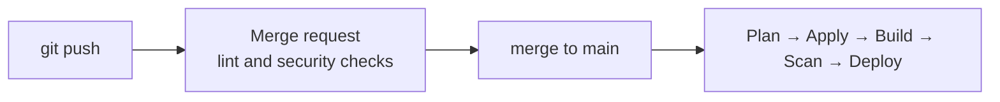

# Delivery: bootstrap, Infrastructure as Code and CI/CD

## From zero to automated operation

A pipeline that deploys with OIDC into remote state has a chicken-and-egg problem: it needs a managed identity and a state backend that only exist after a first deployment. Container apps have a second one: they reference an image that does not yet exist in the registry. Delivery therefore runs in three phases.

| Phase | Runs | Content |
|---|---|---|
| 1. Azure bootstrap | Locally, once, with an admin account | `bootstrap/`: state backend, OIDC identity for the pipeline, Entra app registration. Outputs go into `infra/secrets.auto.tfvars` (git-ignored) and into protected CI variables |
| 2. Image bootstrap | Locally, once | Build the first frontend and backend images in the registry, then the first `apply` of `infra/` |
| 3. Automated delivery | GitLab CI/CD, permanently | Lint → plan → manual apply → image build and scan → manual image deploy |

After phase 2, every change goes through the pipeline. Production infrastructure and image rollouts are deliberately released manually.

### Phase 1: bootstrap stack

[`bootstrap/`](../bootstrap) is a separate stack with local state, run once by an account that may create app registrations ([instructions](../bootstrap/README.md)).

| Module | Resources |
|---|---|
| `state_backend` | Resource group, storage account `sttfstatescape`, blob container, RBAC for the operator |
| `maker_identity` | User-assigned managed identity `mi-maker-escape`, federated credential for the GitLab environment `production`, Contributor and User Access Administrator on the subscription, Storage Blob Data Contributor on the state |
| `entra_auth` | App registration `cloud-escape-lab`, service principal, client secret for EasyAuth, owners |

The outputs `entra_client_id` and `entra_client_secret` are stored as protected CI variables `TF_VAR_entra_client_id` and `TF_VAR_entra_client_secret`.

### Phase 2: image bootstrap

On the very first `apply`, the container apps would reference images that do not exist yet and the run would fail. The first images are therefore built once directly in the registry:

```bash
az acr build --registry acrlabprodescape --image frontend:bootstrap ./frontend/
az acr build --registry acrlabprodescape --image backend:bootstrap ./backend/
```

From then on, images are only built by the pipeline and tagged with the commit SHA. The `bootstrap` tag is a placeholder for the first start.

## Infrastructure as Code

The infrastructure is written in HCL for OpenTofu, chosen for its open licence and open-source-first approach, and stays compatible with Terraform providers. The pipeline currently runs the Terraform 1.7 CLI.

### State separation

```text
bootstrap/   local state                            once, admin account
infra/       remote state infrastructure.tfstate    Azure Blob Storage, used by the pipeline
```

### Platform stack modules

| Module | Resources |
|---|---|
| `network` | Subnets `snet-aca` and `snet-pe` in the existing spoke VNet |
| `acr` | Azure Container Registry, Basic SKU |
| `aca_env` | Container Apps environment with internal load balancer and Log Analytics |
| `aca_app` | Container apps for frontend and backend, including `AcrPull` role assignment |
| `aca_auth` | EasyAuth configuration of the frontend (Entra ID, login redirect, audience validation) |

Each module only exposes the outputs other modules or the pipeline need, so modules can be refactored without breaking state dependencies.

### Tags owned by central governance

Almost every resource sets `lifecycle { ignore_changes = [tags] }`. Tags are set and inherited at subscription level by the landing zone. Without `ignore_changes`, every plan would show these tags as drift and might reset them. Managing all tags in IaC and treating policy changes as drift was rejected so as not to work against central tag governance.

## CI/CD pipeline

The GitLab pipeline ([`.gitlab-ci.yml`](../.gitlab-ci.yml)) behaves differently for merge requests and `main`:

| Trigger | Stage | Content |
|---|---|---|
| Merge request | Lint | `terraform fmt -check`, `terraform validate`, `tflint`, Checkov, `pip-audit` for frontend and backend |
| `main` | Plan | `terraform plan` for `infra/`, plan stored as artifact |
| `main` | Apply | Manual `terraform apply` (fresh plan, because saved plans can contain short-lived OIDC credentials) |
| `main` | Build | Docker build and push of both images, tagged with commit SHA and `latest` |
| `main` | Image scan | Trivy scan of the pushed images |
| `main` | Deploy | Manual `apply` with `frontend_image_tag` and `backend_image_tag`; each new tag creates a new container app revision |



### Git flow

A lightweight branching model keeps `main` releasable at all times: `feature-*`, `fix-*` and `hotfix-*` branches are merged through merge requests only, and the pipeline acts as the merge gate. Releases (MVP, MLP, MMP) are marked with tags.

### Secretless authentication with OIDC

For every job GitLab issues a short-lived OIDC token. The managed identity `mi-maker-escape` trusts exactly one subject, `project_path:<group>/cloud-escape-lab:environment:production`, so only jobs that run in the `production` environment can access Azure. Lint jobs on merge requests do not log in to Azure at all.

### Custom CI image

Build, scan and deploy jobs use a dedicated image ([`ci/Dockerfile`](../ci/Dockerfile)) based on `mcr.microsoft.com/azure-cli` (CBL-Mariner, packages via `tdnf`). It adds only the Docker CLI and Trivy, so one small image covers all three tools. No suitable public image with Azure CLI and Docker CLI existed.

### Docker-in-Docker

Images are built with the `docker:24-dind` service inside the short-lived runner. TLS between client and daemon is disabled (`DOCKER_TLS_CERTDIR: ""`) because both run in the same job-scoped network namespace without external exposure. For long-running daemons TLS would be mandatory.

### Image scanning without registry passwords

Trivy scans the freshly pushed images directly from the registry (`--image-src remote`), without access to a Docker socket. The job signs in to Azure with its federated token, obtains a short-lived ACR access token and passes it to Trivy. The scan step uses no static credentials either.
