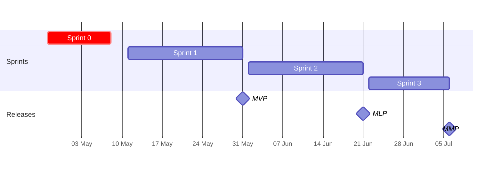
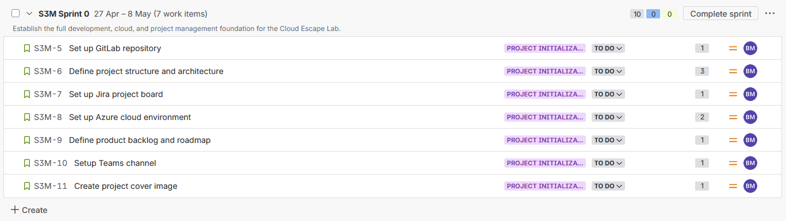
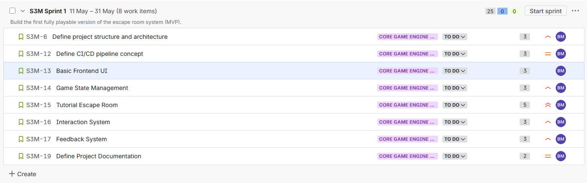
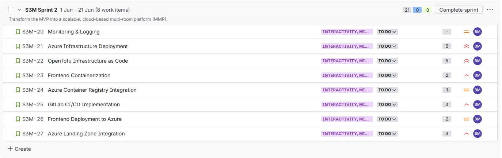
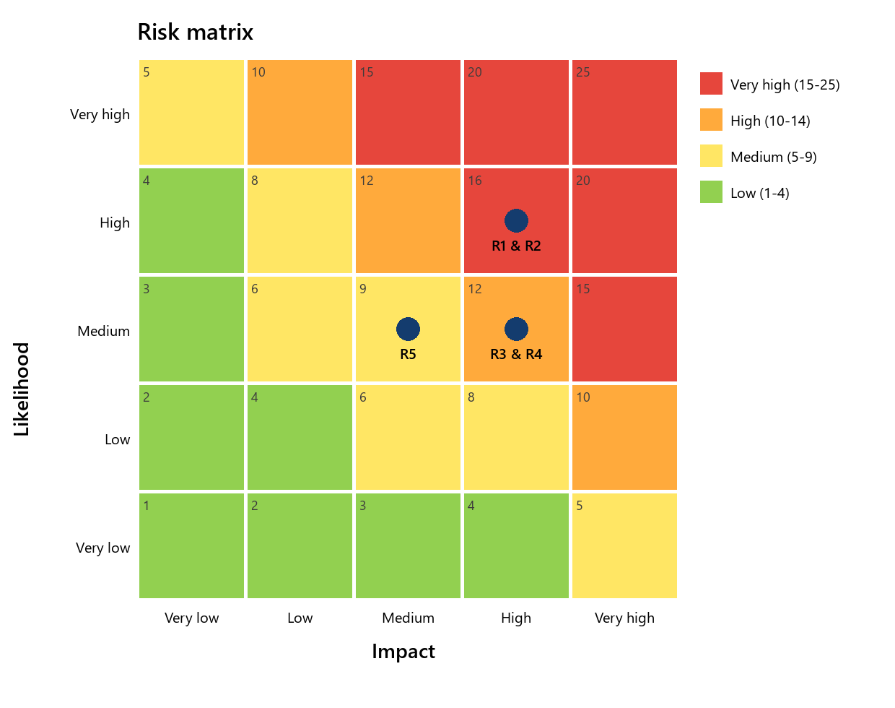

# Project management

## Problem

IT education often teaches technical topics in theory or through isolated exercises, which makes it hard for learners to understand complex relationships and apply them in realistic scenarios. Many topics require initiative and practical understanding that classic methods support only partly. Gamification and interactive challenges address this.

## Goals

- A working cloud-based escape room platform with at least one fully playable scenario
- A microservice architecture with separate frontend and backend
- An automated GitLab CI/CD pipeline for build, test and deployment
- Authentication with Microsoft Entra ID
- Infrastructure provisioned automatically with OpenTofu
- A relational database (SQLite) for game states, sessions and leaderboard times
- Complete documentation including architecture, deployment and lessons learned

## Scope

The deliverable is a **proof of concept** that demonstrates technical feasibility and the core architecture. A full production rollout, additional escape room scenarios, advanced game mechanics and operating processes are out of scope.

## Method and tools

The project followed **Scrum** with a sprint 0 for setup and three delivery sprints, each closed with a review and a retrospective (Mad, Sad, Glad on a Miro board). Story points were estimated with the Fibonacci sequence.

| Area | Tools |
|---|---|
| Planning | Jira (backlog, sprints, roadmap), Miro (retrospectives) |
| Development | VS Code, Python, Docker, Git, GitLab; AI assistants for research and coding support |
| Cloud | Azure portal and CLI, Azure Container Apps, Entra ID, OpenTofu |

### Definition of Ready

- **Content:** clear description following the Scrum template, visible value, acceptance criteria, linked to a release (MVP, MLP or MMP).
- **Technical:** dependencies, affected components (frontend, backend, database, cloud) and risks identified; infrastructure, container or CI/CD preparation done where needed.
- **Plannable:** fits into one sprint, split into subtasks where needed, estimated and prioritised.

### Definition of Done

- **Implemented:** all acceptance criteria met, code implemented and tested.
- **Validated:** functional tests or manual checks done; containers, APIs or cloud resources tested where relevant; works in the target environment.
- **Documented and traceable:** decisions and steps documented, changes versioned, commits and merge requests linked to Jira.
- **Integrated:** pipeline passed where relevant, presented in the sprint review, set to *Done*.

A Jira automation rule added the key DoD criteria to every new story.

## Roadmap and timeline

| Sprint | Period | Focus | Release |
|---|---|---|---|
| 0 | 27.04.–08.05.2026 | Setup: GitLab, Jira, Azure, backlog | – |
| 1 | 11.05.–31.05.2026 | Core platform and game engine: frontend, game state, tutorial room, interactions | **MVP**: architecture and a playable prototype |
| 2 | 01.06.–21.06.2026 | Containers, Azure deployment with OpenTofu, landing zone integration, CI/CD, monitoring | **MLP**: automated, reproducible and secured delivery |
| 3 | 22.06.–06.07.2026 | Entra ID, pipeline automation, testing, bug fixing, documentation | **MMP**: production-ready, tested and documented |

## Sprints

### Sprint 0: setup

Repository, Jira board, Azure environment, product backlog and roadmap.

### Sprint 1: MVP

**Goal:** basic platform architecture and a first playable escape room. **Result:** reached; all stories done: project structure and architecture, CI/CD concept, basic frontend UI, game state management, tutorial room, interaction and feedback system, documentation structure.

### Sprint 2: MLP

**Goal:** first end-to-end deployment of the containerised platform to Azure with OpenTofu, GitLab CI/CD, OIDC, monitoring and routing through the central Application Gateway. **Result:** reached. Landing zone integration and troubleshooting around routing and OIDC took longer than expected but were solved within the sprint. Stories: monitoring and logging, Azure infrastructure, OpenTofu IaC, frontend containerisation, registry integration, CI/CD, frontend deployment, landing zone integration.

### Sprint 3: MMP

**Goal:** Entra ID–protected frontend, stable end-to-end deployments, completed tests and documentation. **Result:** reached on 06.07.2026; all stories and all four epics done: Entra ID authentication, automated room deployment, unit and integration tests, end-to-end tests, bug fixing, documentation, final presentation and delivery.

## Risk management

Likelihood and impact were rated from 1 to 5; their product is the risk level: low (1–4), medium (5–9), high (10–14), very high (15–25).

| ID | Risk | Initial | After S1 | After S2 | Final | Mitigation |
|---|---|:-:|:-:|:-:|:-:|---|
| R1 | Architectural complexity makes implementation and troubleshooting hard | 16 | 12 | 8 | 6 | MVP focus, clear architecture, step-by-step implementation |
| R2 | Effort exceeds the available time | 16 | 16 | 12 | 8 | Prioritise core features, iterate |
| R3 | CI/CD pipeline issues block automated deployments | 12 | 8 | 4 | 4 | Build the pipeline step by step, early lint and validation checks |
| R4 | Problems integrating Entra ID authentication | 12 | 12 | 8 | 6 | Implement and test authentication early |
| R5 | Faulty OpenTofu definitions break deployments | 9 | 6 | 4 | 4 | Validate regularly, real deployments, linting |

All risks decreased over the project and none materialised in a way that endangered the result. The two largest initial risks (R1, R2) were reduced most by the MVP-oriented, iterative approach. Time (R2) remained the most relevant residual risk of a project with a fixed deadline; authorisation through app roles remained open for R4.

## SWOT analysis

| Strengths | Weaknesses |
|---|---|
| Self-built platform that is easy to scale and maintain | High complexity from many technologies |
| Current technologies: microservices, CI/CD, IaC, Entra ID | Limited time frame |
| Modular design allows extensions | Dependency on cloud services and connectivity |
| Automated, reproducible infrastructure with OpenTofu | Risk of over-engineering with a large scope |

| Opportunities | Threats |
|---|---|
| Further development for productive use | Integration problems between Azure services |
| More escape room scenarios | Delays caused by technical challenges |
| Practical cloud-native and DevOps experience | Unexpected complexity in service-to-service communication |
| Motivating, hands-on learning for students | Security or authentication issues with Entra ID |
