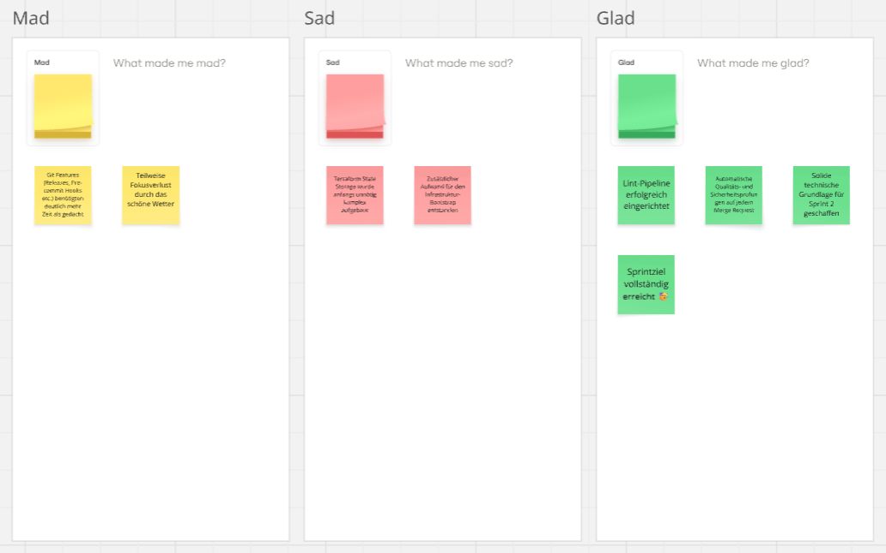
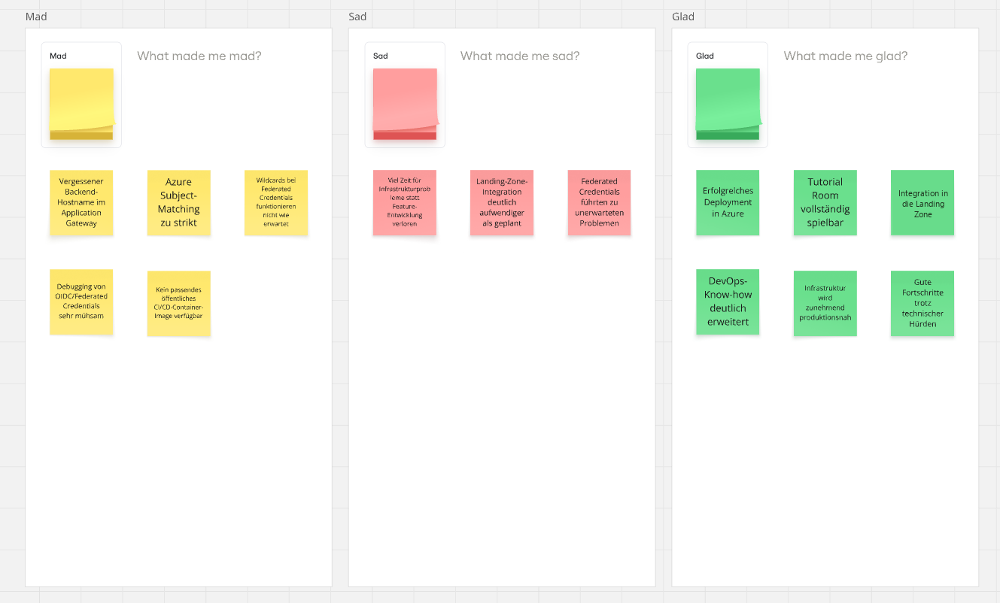
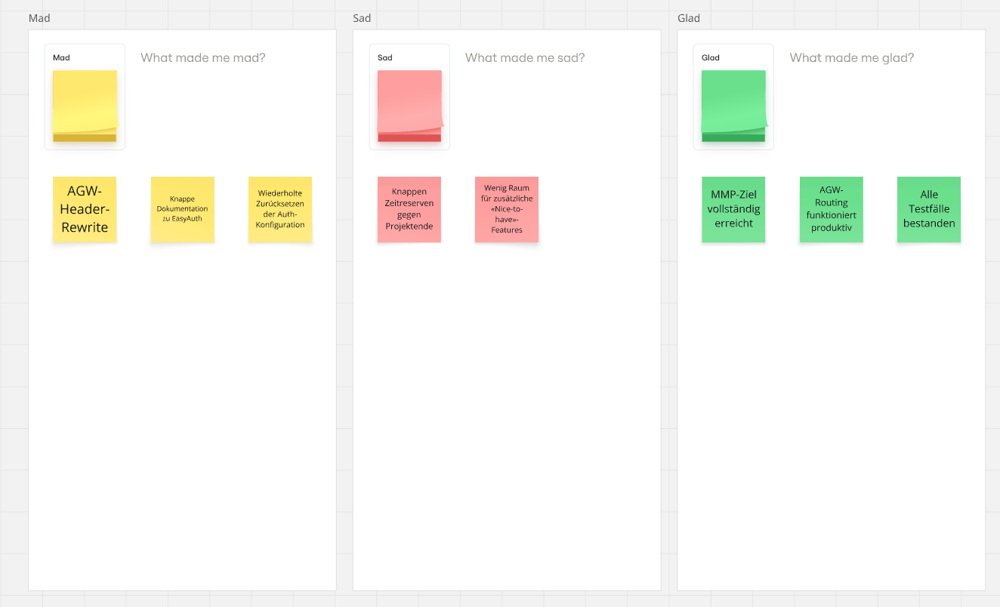

# Retrospective

## Lessons learned

### Sprint 1

- **Choose the state backend early.** The self-managed remote state in Azure Storage made the bootstrap code larger; GitLab-managed state would have halved it and simplified locking.
- **Decide the OIDC trust model early.** An environment-based federated credential proved more robust than reworking pipeline authentication later.
- **Introduce platform features deliberately.** Exploring GitLab features (Pages, releases, cleanup policies) cost more time than planned; such work is now planned as explicit stories.
- **Early pipeline checks pay off.** `validate`, `fmt`, `tflint`, Checkov, `pip-audit` and later Trivy surface problems long before an Azure deployment.

### Sprint 2

- **Plan Application Gateway and DNS completely upfront.** Troubleshooting was caused by a missing backend host name and a missing internal DNS record.
- **Landing zone integrations need generous buffers.** Existing governance, network and security requirements make integration more complex than a greenfield setup.
- **Validate federated credentials first.** Small deviations in subject matching mean Azure finds no matching federated identity.
- **Design branching and OIDC together.** Subject matching ties CI/CD architecture and branching strategy closely together.
- **A custom CI image saves effort in the long run** and gives reproducible build environments.
- **End-to-end deployments reveal integration issues reliably.**
- **Containerisation removes differences** between development and target environment.
- **Plan realistic capacity**, including personal availability.

### Sprint 3

- **EasyAuth on Container Apps needs its own API resource** (`authConfigs/current`), managed with `azapi`, plus `ignore_changes = [secret]` on the container app.
- **Reverse proxies break redirect URIs.** The gateway rewrites `Host`; injecting `X-Forwarded-Host` and setting `forwardProxy.convention = "Standard"` fixes the OAuth2 callback. The pattern is barely documented.
- **Application Gateway v2 does not send `X-Original-Host`** automatically, contrary to some sources.
- **Coordinate health probes with authentication.** With EasyAuth active, `/` answers probes with `302`, the pool turns unhealthy and users get `502`. An excluded `/healthz` path solves it.

## Technical conclusion

The central goals were reached: the platform is publicly reachable with a playable tutorial room, protected by a valid certificate and Entra ID, and all ten test cases passed. The following decisions proved right:

- **Hub-and-spoke with a central Application Gateway and WAF:** secure ingress and path-based routing, no public endpoints on the workloads.
- **Infrastructure fully as code:** the environment is reproducible, and real deployments exposed configuration errors early.
- **Secretless CI/CD with OIDC:** no stored credentials; the custom CI image keeps builds reproducible, and tags make releases referenceable.
- **EasyAuth in front of the app:** no authentication code in the application, at the price of understanding the `authConfigs` resource and the proxy behaviour in depth.

Two pragmatic scope decisions fit the proof of concept: file-based SQLite persistence, and game logic inside the backend container. For permanent operation, an external database and optionally a serverless function for selected game interactions are planned.

## Personal conclusion

I built a complete cloud-native solution on my own, from the first architecture sketch to a publicly reachable, secured product. Most valuable was making landing zone, networking, identity and CI/CD work together in a real environment instead of treating them in theory.

The hardest part was not a single technology but the interplay of many components under time pressure. Debugging the gateway and the EasyAuth redirect URI taught me to think network and authentication flows through completely before the first deployment, and to prioritise strictly by MVP to deliver a robust result in limited time. I gained a much deeper understanding of passwordless authentication, Infrastructure as Code and running container workloads in a regulated enterprise environment.

## Next steps

- **Group-based authorisation** with app roles (`Escape.Player`, `Escape.Admin`) mapped to Entra ID groups.
- **Persistent data** in an external PostgreSQL database so game states and leaderboards survive deployments.
- **More themed escape rooms**, each running as its own isolated container.
- **Scheduled deployment** that creates and removes room containers on a timetable to reduce costs for time-limited use such as lessons.
- **Event-driven Azure Function** for selected game interactions.
- **Production go-live** with monitoring and an operating model.
