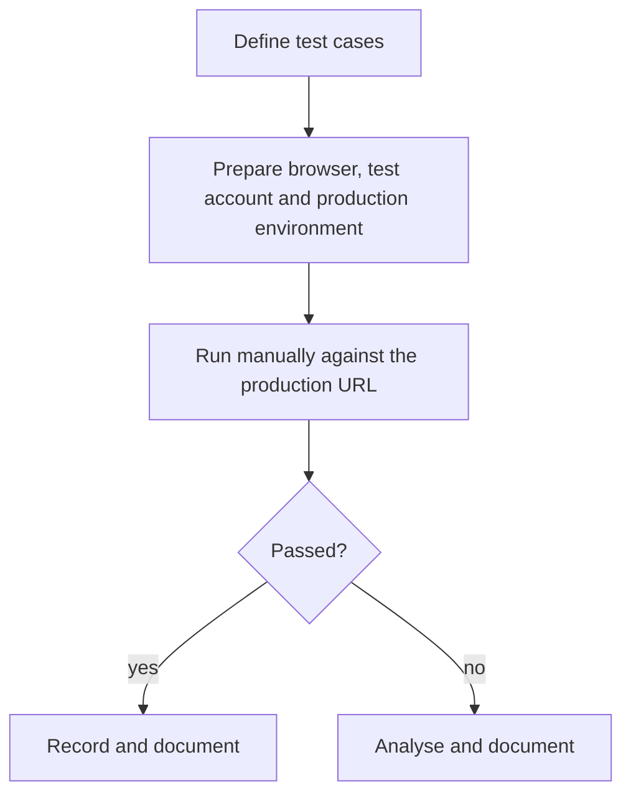
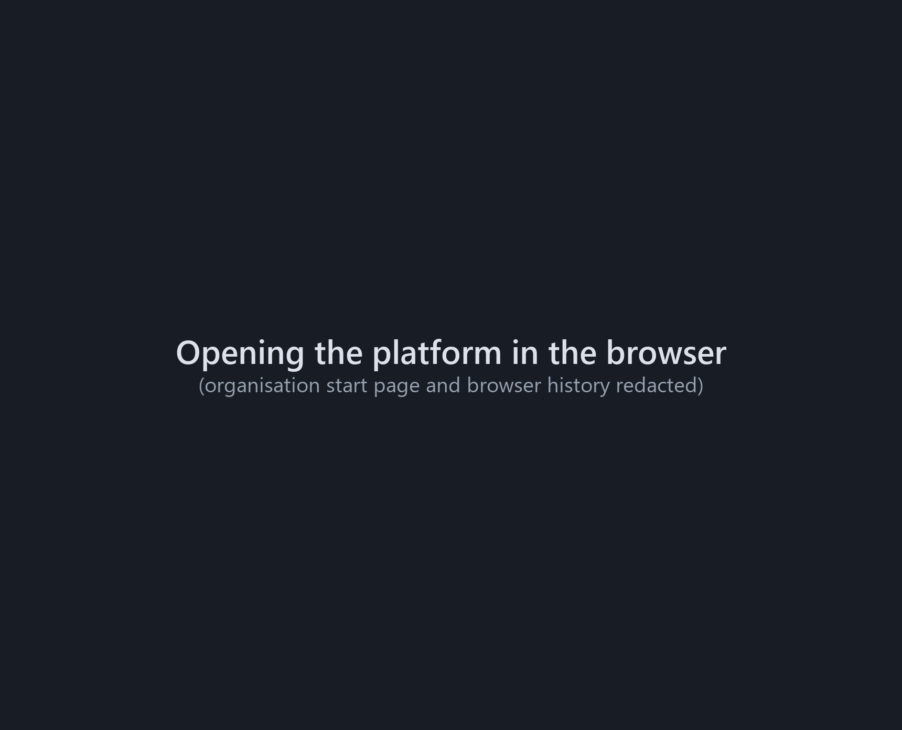
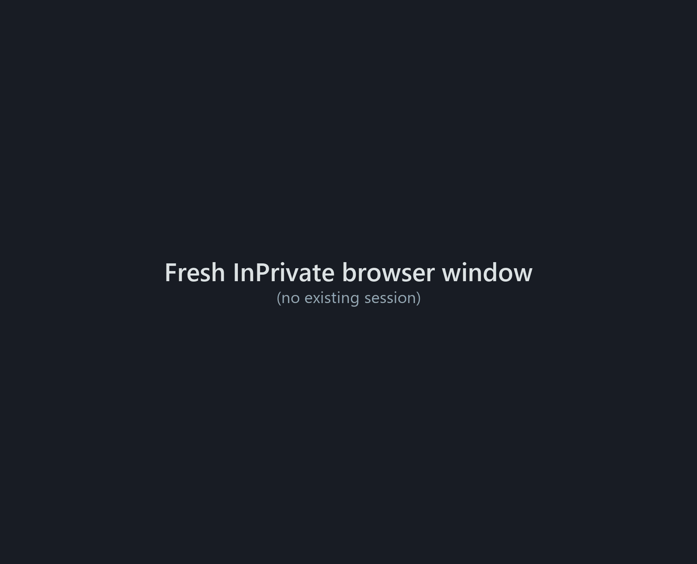
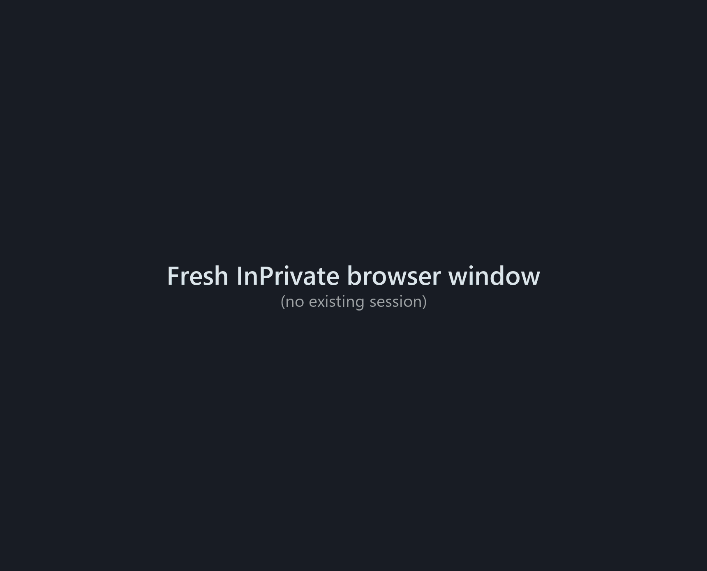
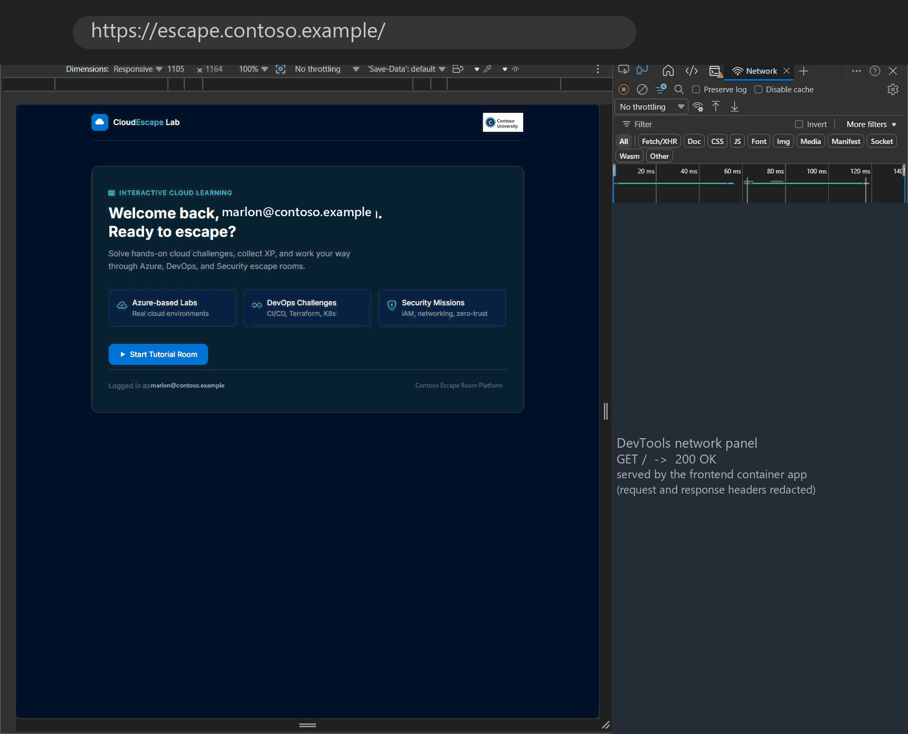
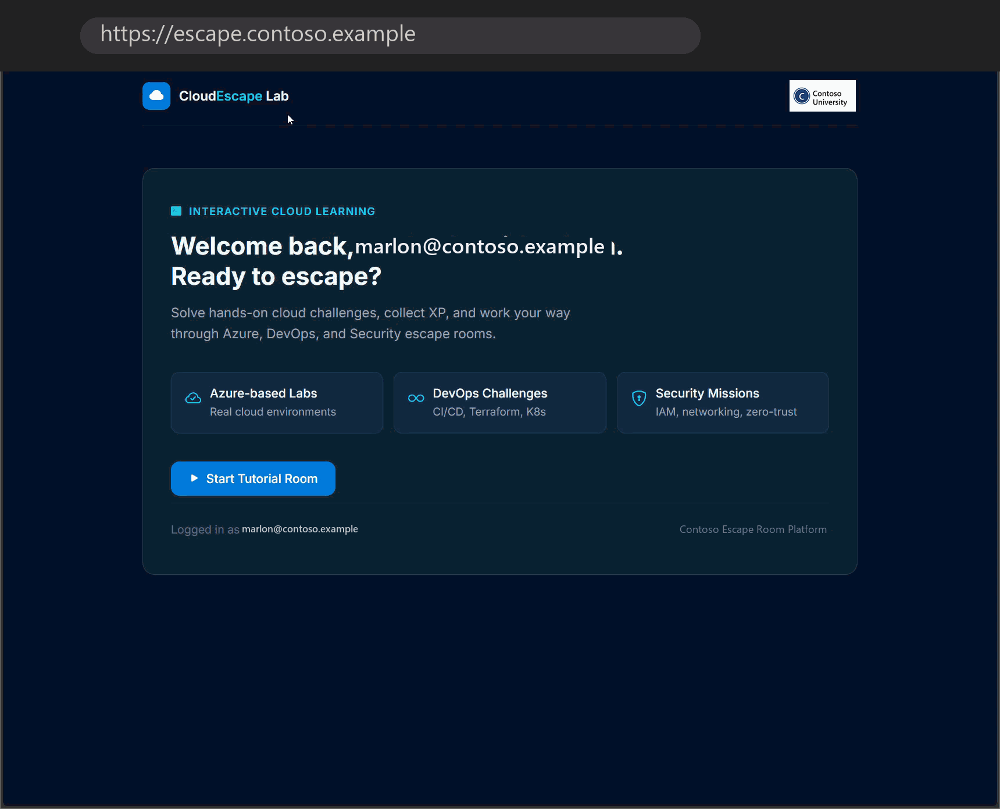
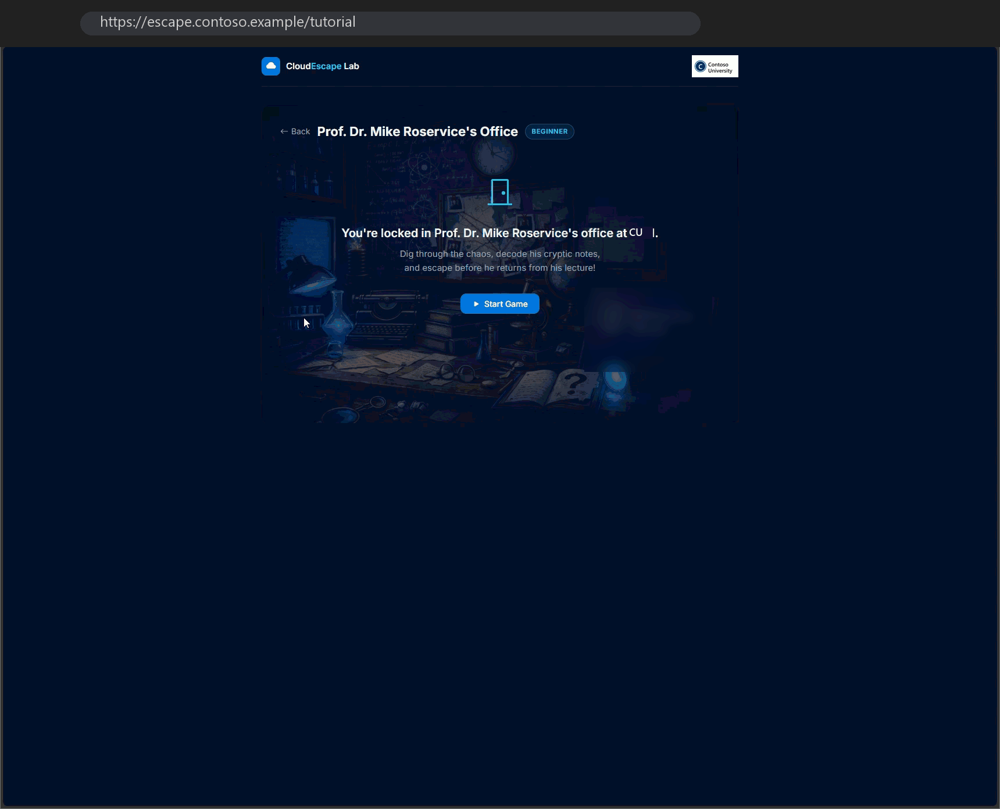
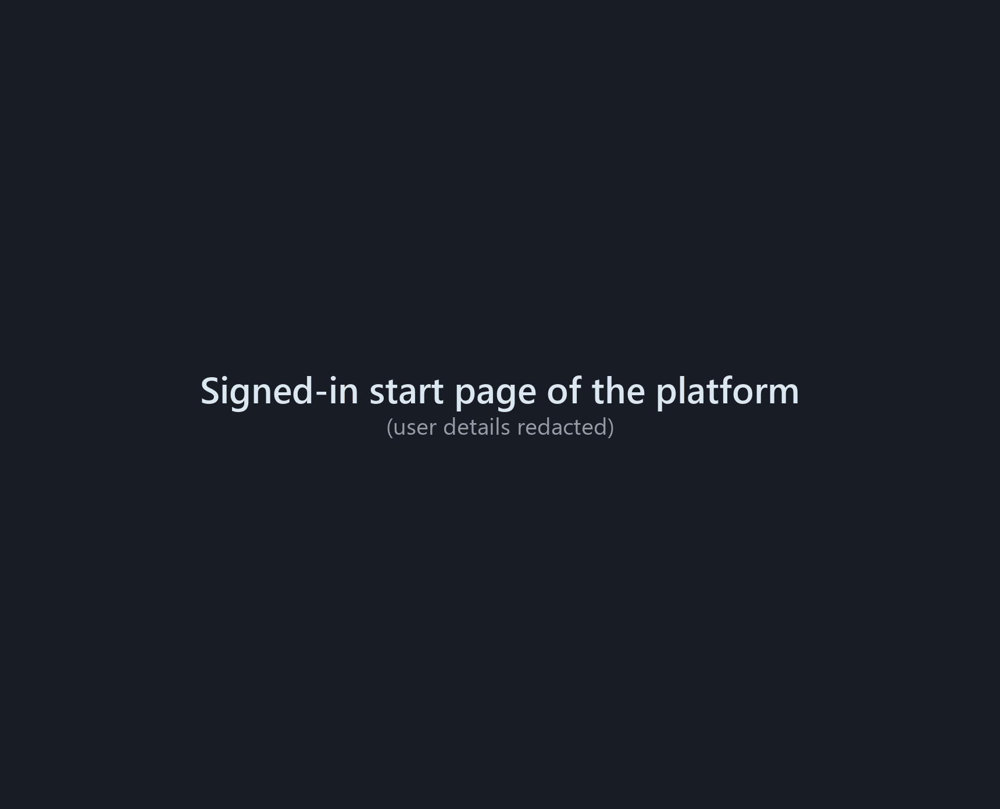
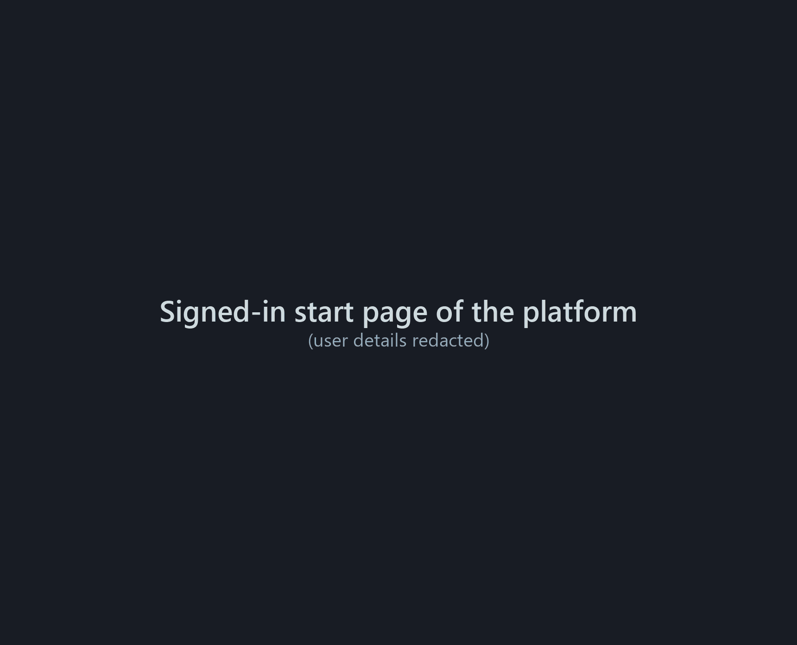
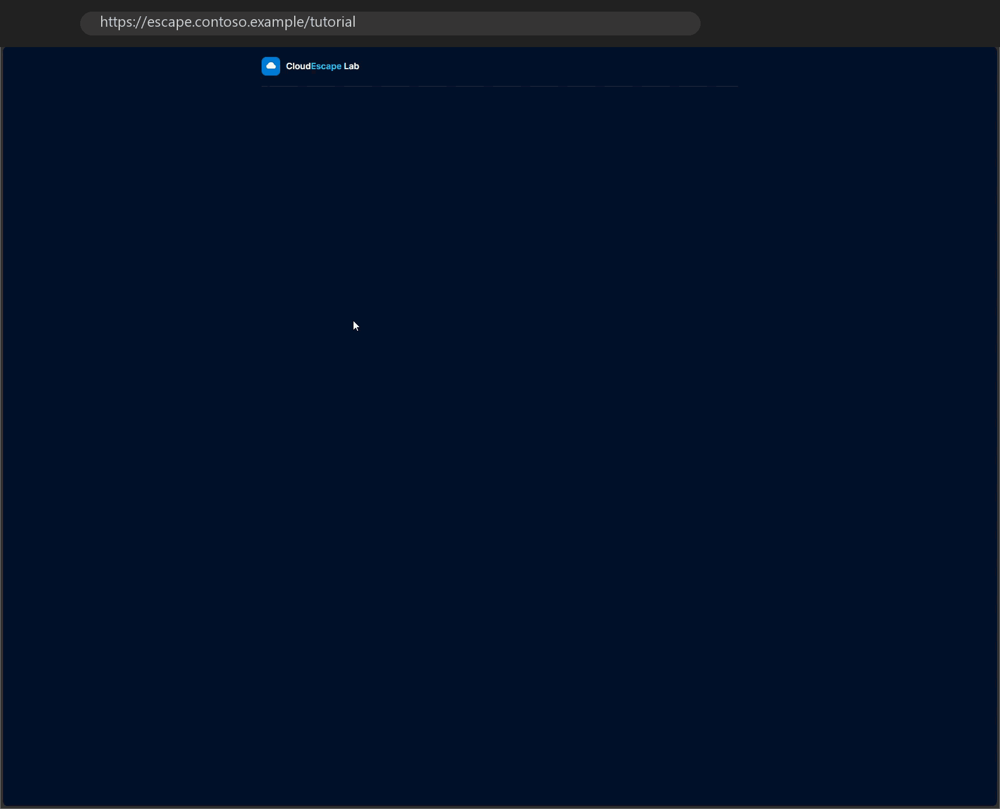

# Testing

## Scope and approach

The tests verify the **platform**, not the puzzle content of the tutorial room. They were run manually against the deployed production URL to prove that the environment works end to end: reachability, TLS, authentication, routing, WAF and the full game lifecycle.

The tutorial room itself (`frontend/app/templates/tutorial.html`, `backend/app/rooms/tutorial/`) is adapted from [`ma-room-template`](https://gitlab.com/solvista/ma-room-template) and was not substantially changed. It serves as realistic content for testing the platform built in this project.

> **About the recordings:** the GIFs were recorded in the original environment. Organisation-specific content was removed afterwards: the browser address bar shows a neutral URL, sign-in pages and browser internals are replaced by short title cards, and logos, e-mail addresses and certificate details are replaced or summarised.

## Results

| # | Test case | Result |
|---|---|---|
| 1 | Public reachability and TLS certificate | Passed |
| 2 | Enforced authentication without a session (EasyAuth redirect) | Passed |
| 3 | Successful sign-in with Microsoft Entra ID | Passed |
| 4 | Health probe path reachable without sign-in | Passed |
| 5 | Path-based routing through the Application Gateway | Passed |
| 6 | WAF protection at the central Application Gateway | Passed |
| 7 | End to end: load and start the tutorial room | Passed |
| 8 | Complete user journey until the room is solved | Passed |
| 9 | Reset the game to its initial state | Passed |
| 10 | Stop, delete and restart the room runtime | Passed |

**10 of 10 test cases passed.** Public access, TLS termination and WAF protection at the central gateway work as intended. EasyAuth reliably enforces sign-in, keeps the session for follow-up requests and leaves the health probe path open. Path-based routing separates frontend and backend under one host name, and the tutorial room can be played, reset, stopped, deleted and restarted. No critical security or functional defects were found within this scope.

## Test cases

### 1. Public reachability and TLS certificate

| | |
|---|---|
| Preconditions | Browser with internet access; no VPN required |
| Steps | 1. Open `https://escape.contoso.example/` 2. Inspect the certificate (issuer, validity, domain) 3. Check that no "not secure" warning appears |
| Expected | The platform is publicly reachable with a valid wildcard certificate managed at the Application Gateway |
| Actual | Reachable, valid certificate, no warning |

### 2. Enforced authentication without a session

| | |
|---|---|
| Preconditions | Private browser window without a session |
| Steps | 1. Open `https://escape.contoso.example/` 2. Observe the redirect 3. Check that no page content is shown |
| Expected | Automatic redirect to `login.microsoftonline.com`; no content without sign-in |
| Actual | Redirect as expected, no content delivered |

### 3. Sign-in with Microsoft Entra ID

| | |
|---|---|
| Preconditions | Valid account in the organisation's tenant |
| Steps | 1. Sign in on the Microsoft page 2. Follow the redirect chain 3. Reload and check that no new sign-in is required |
| Expected | Redirect to `/.auth/login/aad/callback`, then the start page; the session cookie persists |
| Actual | As expected; reloading required no new sign-in |

### 4. Health probe path without sign-in

| | |
|---|---|
| Preconditions | Client without a session |
| Steps | 1. `GET https://escape.contoso.example/healthz` 2. Check status and payload |
| Expected | `200 {"status":"ok"}` without redirect, because `/healthz` is an excluded path; required for a healthy backend pool |
| Actual | `200 {"status":"ok"}`, no redirect |

### 5. Path-based routing

| | |
|---|---|
| Preconditions | Signed-in session |
| Steps | 1. Open `/` and check the frontend page 2. Open `/tutorial-room/ping` and check the JSON response 3. Compare response headers in the developer tools |
| Expected | `/` is served by the frontend, `/tutorial-room/*` by the backend, both under the same host name |
| Actual | Frontend HTML and backend JSON under the same host, as expected |

### 6. WAF protection

| | |
|---|---|
| Preconditions | Signed-in session |
| Steps | 1. Open `https://escape.contoso.example/?q=` 2. Check the status code 3. Check that the payload is not reflected |
| Expected | The OWASP CRS rules block the request with `403` before it reaches the platform |
| Actual | `403 Forbidden` from the Application Gateway, no reflection |

### 7. Load and start the tutorial room

| | |
|---|---|
| Preconditions | Signed-in session |
| Steps | 1. Open `/tutorial` 2. Click **Start Game** 3. Check that the room state loads 4. Interact with the light switch |
| Expected | The room loads, the game starts and the first interaction works (integration test of the platform, not of the puzzle logic) |
| Actual | As expected |

### 8. Complete user journey

| | |
|---|---|
| Preconditions | Signed-in session, room started |
| Steps | Light switch → examine desk → use office key on desk → examine journal → enter code at exit terminal |
| Expected | The room can be solved and the success banner appears |
| Actual | Completed without interruption; the success banner appeared |

### 9. Reset the game

| | |
|---|---|
| Preconditions | Room started, at least one interaction done |
| Steps | 1. Use the light switch 2. Check that new objects appear 3. Click **Reset** 4. Check the initial state |
| Expected | The room returns to its initial state |
| Actual | Unlocked objects disappeared; the initial state was restored |

### 10. Stop, delete and restart the runtime

| | |
|---|---|
| Preconditions | Room started |
| Steps | 1. Interact once 2. **Stop Room** 3. **Start Game** 4. **Delete Room** 5. **Start Game** again |
| Expected | Stop and delete end the runtime and return to the start view; a fresh room can be started each time |
| Actual | As expected |

